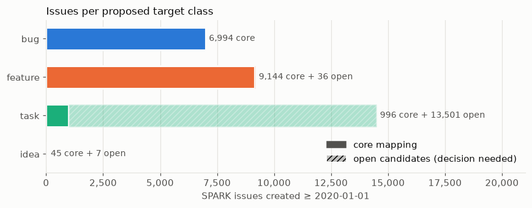
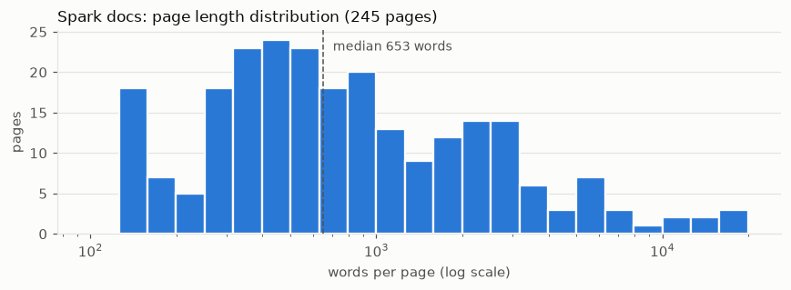
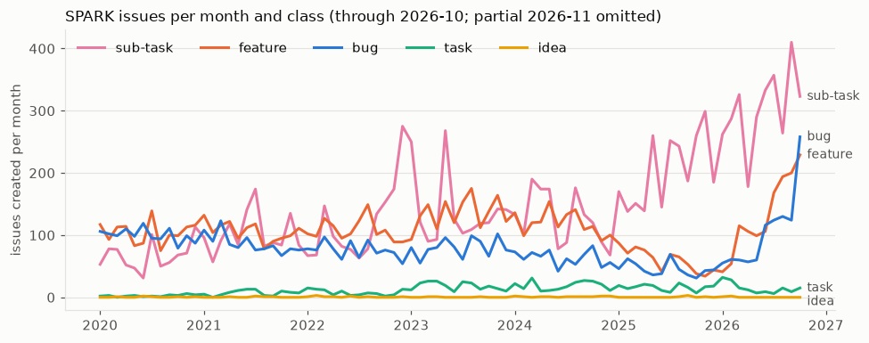

# 02 · Data Understanding — Spark Jira tickets and docs

_CRISP-DM phase: Data Understanding · data snapshot 2026-11-15 · evidence and code: [`notebooks/eda.ipynb`](../notebooks/eda.ipynb)_

This report describes the raw data and collects evidence for Data Preparation decisions.
`data/raw/` was not modified, no eval sets were built, and **none of the decisions at the end has been applied**.
All tables below are copied from the executed notebook. Example texts are masked: e-mails, Jira/GitHub user mentions and explicit person names.

**Inputs**

| file | issues | unique keys | projects | created from | created to |
|---|---:|---:|---:|---|---|
| spark_issues.jsonl | 31290 | 31290 | 1 | 2020-01-01 | 2026-11-15 |
| spark_wish_all.jsonl | 158 | 158 | 1 | 2014-04-17 | 2026-02-18 |
| wish_other.jsonl | 1500 | 1500 | 190 | 2020-09-18 | 2026-11-10 |

- All 45 SPARK Wish issues created since 2020 are also in `spark_wish_all.jsonl`.
- **41 of the 1,500 `wish_other` issues are SPARK issues**, and all 41 are also in `spark_wish_all.jsonl`. This overlap must be handled whenever both files are used.

## Key findings

1. **The classes are very imbalanced.** Using only the unambiguous ("core") types: bug 6,994 · feature 9,144 · task 996 · idea 45 (0.3%). Sub-task (12,280 issues, 39% of SPARK) is the largest issue type, so how it is mapped decides how big and what kind of class "task" is.
2. **Wish issues from other ASF projects reveal their project.** 63% name their own project; only 1.5% mention Spark, against 40% of SPARK issues. Used as-is, a model would learn "not about Spark ⇒ idea".
3. **Bug reports rarely spell out a reproduce / expected / actual structure.** Among non-empty Bug descriptions, 14% use explicit reproduce wording, 19% state expected and 21% actual behaviour. Only 3.4% contain all four elements (reproduce, expected, actual, version/environment). Most bugs show the problem instead: 49% include a code block and 42% an error or stack trace.
4. **37% of SPARK issues have an empty description.** That is 56% of Sub-tasks, 33% of Tasks, 30% of Improvements, 15% of Bugs and about 2% of Wishes, so an empty description on its own hints at the issue type.
5. **2026 looks different from earlier years.** Bug filings went from about 60/month in early 2026 to 258 in October and 530 in the first half of November. Most are filed by developers together with a pull request, often for the new Rust-based Connect client. Bug descriptions doubled in length and became templated: Jira headings in 12%, "root cause" / "proposed fix" sections in 11%.
6. **Duplicate links are reliable enough for a duplicate-detection evaluation.** There are 484 unique duplicate pairs. The link direction agrees with the resolution field: 76% of the issues marked as the duplicate are resolved "Duplicate", against 18% of the originals. For 89% of the pairs, the original is also in the dataset.
7. **Features usually get done; Wishes usually don't.** New Feature / Improvement are Fixed in 56–66% of cases, SPARK Wishes in 11%. Wishes mostly end as Incomplete (20%, all bulk-closed), Won't Fix (17%) or Not A Problem (11%).
8. **Personal data is rare but present.** In SPARK descriptions: Jira user mentions in 0.4% of issues, e-mails in 0.1% (many are placeholders), explicit names in about 10 issues. Summaries are essentially clean. URLs are common (16% of descriptions), mostly links to GitHub pull requests.
9. **The documentation is dominated by SQL reference pages.** 245 pages, 3.3 MB, 402k words; half are SQL reference pages. Only 38% of pages use `##` headers, because SQL reference pages use `###`. Every page starts with a Jekyll metadata block, 29% contain Liquid template tags, and 15% contain `include_example` placeholders whose code lives outside `docs/`.

## 1. Volume per issue type and per proposed target class

Proposed mapping of Jira issue types to the four target classes:
- **core**: the mapping is unambiguous.
- **open**: plausible, but needs a decision (D1, D2).
- **exclude**: not a ticket the assistant should help write.

| issuetype | issues | % of SPARK | proposed_class | status | rationale |
|---|---:|---:|---|---|---|
| Sub-task | 12280 | 39.2 | task | open | Child of any parent type; parent not downloaded |
| Improvement | 8142 | 26 | feature | core | Enhancement of existing functionality = feature request from a user's view |
| Bug | 6994 | 22.4 | bug | core | Defect report |
| New Feature | 1002 | 3.2 | feature | core | New functionality |
| Task | 996 | 3.2 | task | core | Work item without new user-facing behaviour |
| Test | 798 | 2.6 | task | open | Engineering work: tests |
| Umbrella | 336 | 1.1 | — | exclude | Container of sub-tasks (roadmap text) |
| Documentation | 309 | 1 | task | open | Engineering work: docs |
| Question | 161 | 0.5 | — | exclude | User-support question, not a work item |
| Dependency upgrade | 114 | 0.4 | task | open | Engineering work: build/deps |
| Epic | 53 | 0.2 | — | exclude | Container |
| Wish | 45 | 0.1 | idea | core | Jira: 'General wishlist item' |
| Story | 36 | 0.1 | feature | open | Agile story ≈ feature |
| Brainstorming | 7 | 0 | idea | open | Exploratory proposal ≈ idea |
| IT Help | 5 | 0 | — | exclude | Admin/infra type, < 10 issues |
| Request | 4 | 0 | — | exclude | Admin/infra type, < 10 issues |
| Github Integration | 3 | 0 | — | exclude | Admin/infra type, < 10 issues |
| RTC | 3 | 0 | — | exclude | Admin/infra type, < 10 issues |
| Planned Work | 1 | 0 | — | exclude | Admin/infra type, < 10 issues |
| Blog - New Blog Request | 1 | 0 | — | exclude | Admin/infra type, < 10 issues |

Volume per class (SPARK issues created since 2020; Wish from other projects not included):

| class | core types | core issues | open candidates | core + open | core % | core+open % |
|---|---|---:|---|---:|---:|---:|
| bug | Bug | 6994 | — | 6994 | 40.7 | 22.8 |
| feature | Improvement, New Feature | 9144 | Story (36) | 9180 | 53.2 | 29.9 |
| task | Task | 996 | Sub-task (12280), Test (798), Documentation (309), Dependency upgrade (114) | 14497 | 5.8 | 47.2 |
| idea | Wish | 45 | Brainstorming (7) | 52 | 0.3 | 0.2 |

```
Excluded types: 567 issues (1.8%)
Extra idea sources: SPARK Wish all-time = 158, Wish from other ASF projects = 1500
```



- **Core types only:** idea is 0.3% and task 5.8%. That is too few examples to build a four-class classifier from SPARK data alone.
- **Sub-task decides the shape of the data.** Mapping Sub-task to task would make task the largest class (47%). No other single decision changes the class distribution as much.
- **Excluded types are small:** only 1.8% of issues.

## 2. Text length per issue type

Words are whitespace-separated tokens. Description columns marked `*` are computed over non-empty descriptions only. Issue types with fewer than 30 issues are omitted.

| issuetype | issues | summary words med | summary words p90 | summary chars med | summary chars p90 | desc words med* | desc words p90* | desc chars p90* | empty desc % |
|---|---:|---:|---:|---:|---:|---:|---:|---:|---:|
| Sub-task | 12280 | 7 | 11 | 51 | 77 | 31 | 164 | 1514 | 55.8 |
| Improvement | 8142 | 7 | 12 | 55 | 85 | 47 | 186 | 1599.8 | 30 |
| Bug | 6994 | 9 | 15 | 65 | 104 | 104 | 331 | 4326 | 14.9 |
| New Feature | 1002 | 6 | 11 | 46.5 | 74 | 52 | 203.6 | 1476.5 | 26.3 |
| Task | 996 | 7 | 12 | 54 | 82.5 | 30 | 112.4 | 978.6 | 33.2 |
| Test | 798 | 7 | 11 | 53 | 82 | 36 | 164.2 | 2065.8 | 43.7 |
| Umbrella | 336 | 6 | 9 | 40 | 59 | 43 | 207.7 | 1719.0 | 30.4 |
| Documentation | 309 | 8 | 12 | 56 | 84 | 34 | 122.8 | 989.8 | 20.1 |
| Question | 161 | 9 | 14 | 56 | 96 | 115 | 335.6 | 4422.2 | 1.2 |
| Dependency upgrade | 114 | 5 | 8 | 34 | 54.7 | 14 | 150.0 | 1608.4 | 23.7 |
| Epic | 53 | 6 | 10 | 40 | 67.6 | 59 | 262.6 | 1892.8 | 15.1 |
| Wish | 45 | 8 | 13.6 | 57 | 103.2 | 97.5 | 280.8 | 2422.7 | 2.2 |
| Story | 36 | 8 | 12 | 57.5 | 80.5 | 44 | 262.0 | 1780.6 | 30.6 |
| Wish (SPARK, all-time) | 158 | 7 | 13 | 52 | 79.6 | 79 | 225.8 | 2065.2 | 1.9 |
| Wish (other ASF) | 1500 | 7 | 12 | 49 | 79.1 | 64 | 221 | 2026.5 | 2.8 |

Per class (core mapping; the last row combines all Wish issues):

| class (core mapping) | issues | summary words med | summary words p90 | summary chars med | summary chars p90 | desc words med* | desc words p90* | desc chars p90* | empty desc % |
|---|---:|---:|---:|---:|---:|---:|---:|---:|---:|
| bug | 6994 | 9 | 15 | 65 | 104 | 104 | 331 | 4326 | 14.9 |
| feature | 9144 | 7 | 12 | 54 | 84 | 48 | 187 | 1575 | 29.6 |
| task | 996 | 7 | 12 | 54 | 82.5 | 30 | 112.4 | 978.6 | 33.2 |
| idea | 45 | 8 | 13.6 | 57 | 103.2 | 97.5 | 280.8 | 2422.7 | 2.2 |
| idea (SPARK all-time + other ASF) | 1658 | 7 | 12 | 49 | 79.3 | 66 | 221.8 | 2031.6 | 2.7 |

- **Summaries:** short and similar across types (median 6–9 words, p90 11–15). Bug summaries are the longest (median 9 words / 65 characters).
- **Descriptions:**
  - Bug descriptions are the longest: median 104 words, p90 331. The p90 of 4.3k characters is mostly code and stack traces, roughly 1–1.5k tokens, so a ticket context budget of about 2k tokens covers 90% of bugs.
  - Task descriptions are the shortest (median 30 words).
- **Empty descriptions reveal the issue type:** Sub-task 56%, Test 44%, Task 33%, Improvement 30%, Bug 15%, Wish 2%. A classifier can pick up the type from the absence of text alone.
- **Wish texts look alike in both sources:** long, almost never empty, explaining motivation. Median 79 words for SPARK Wish against 64 for other projects, so their shape is not what differs (vocabulary is; see §4).

## 3. Bug structure (regex / keyword heuristics)

The patterns are applied to Bug descriptions, case-insensitive. Keyword signals run on **prose only**: code blocks and inline code are removed first, so compiler or lint output such as `E302 expected 2 blank lines` does not count. Code, error and version signals run on the full description.
Jira's separate `Affects Version/s` and `Environment` fields were **not downloaded**, so `version_env` only measures what is written in the description text.

| signal | applied to | regex |
|---|---|---|
| repro_keyword | prose | `steps? to reproduc\|how to reproduc\|to reproduce\|reproduc(?:e\|es\|ed\|ing\|tion\|ible)\b\|\brepro\b` |
| code_or_snippet | full description | `\{code\|\{noformat\|```\|^\s*(?:scala\|spark-sql\|sql\|>>)>` |
| expected | prose | `\bexpect(?:ed\|s\|ing)?\b\|\bshould(?:n't\| not)? (?:be\|return\|work\|have\|produce\|give\|succeed\|fail\|throw\|not)\b\|\bsupposed to\b\|\bcorrect (?:result\|output\|answer\|behaviou?r)` |
| actual_explicit | prose | `\bactual(?:ly)?\b\|\binstead\b\|\bbut (?:got\|gets\|get\|it\|returns?\|the result\|we get\|i get)\b\|\bobserved\b\|\b(?:returns?\|gives?\|produces?) (?:a )?(?:wrong\|incorrect\|null\|empty)\b` |
| error_output | full description | `exception\|traceback\|stack ?trace\|\berror\b\|caused by:\|^\s*at [a-z]+\.[\w.$]+\(` |
| version_env | full description | `\b(?:spark\|pyspark)\s*(?:version\s*)?[:=]?\s*v?[1-4]\.\d\|\bversion\s*[:=]?\s*v?\d+\.\d\|\bv?[1-4]\.\d+\.\d+\b\|\benvironment\b\|(?<![.\w])(?:jdk\|java\|openjdk)(?:\s+version)?[\s:=]+(?:1\.8\|8\|11\|17\|21\|25)\b\|\bpython\s*(?:version\s*)?[:=]?\s*3\.\d\|\bscala\s*2\.1[0-3]\|\bhadoop\s*[23]\.\d\|\b(?:ubuntu\|centos\|macos\|mac os\|windows\|rhel\|debian\|amazon linux)\b\|\b(?:emr\|databricks\|dataproc\|hdinsight)\b` |

| signal | % of non-empty Bug descriptions | % of all Bugs |
|---|---:|---:|
| repro_keyword | 14.2 | 12.1 |
| code_or_snippet | 48.7 | 41.4 |
| expected | 18.9 | 16.1 |
| actual_explicit | 20.7 | 17.6 |
| error_output | 42.1 | 35.8 |
| version_env | 28.9 | 24.6 |
| repro_any | 52 | 44.3 |
| actual_any | 54.1 | 46 |
| all_four | 3.4 | 2.9 |

Combined signals:
- `repro_any` = `repro_keyword` OR `code_or_snippet`
- `actual_any` = `actual_explicit` OR `error_output`
- `all_four` = `repro_any` AND `expected` AND `actual_any` AND `version_env`

By year (% of non-empty Bug descriptions):

| year | non-empty bugs | repro_keyword | repro_any | expected | actual_explicit | actual_any | version_env | all_four |
|---:|---:|---:|---:|---:|---:|---:|---:|---:|
| 2020 | 1123 | 10.1 | 54.7 | 16.5 | 15 | 51.6 | 26.2 | 1.6 |
| 2021 | 966 | 12.9 | 53.7 | 13 | 14.9 | 50.9 | 33.6 | 2.2 |
| 2022 | 810 | 13.8 | 59.8 | 19.6 | 16.7 | 57.2 | 33.5 | 4.4 |
| 2023 | 785 | 8.3 | 49.2 | 15.8 | 17.2 | 55.2 | 27.4 | 2.7 |
| 2024 | 554 | 11.6 | 53.4 | 21.3 | 18.8 | 54 | 23.5 | 3.1 |
| 2025 | 409 | 11.5 | 46.5 | 21 | 22 | 52.6 | 22 | 3.7 |
| 2026 | 1302 | 24.4 | 46.5 | 25.1 | 35.2 | 56.6 | 30.5 | 5.5 |

- **Explicit structure is rare.** About half of bugs reproduce the problem with code and show an error, but only about 1 in 5 explicitly says what was expected. The assistant has the most room to help here: asking for "expected vs actual" and the version.
- **2026 changes the picture.** Explicit reproduce and actual-behaviour wording jumps in 2026 (24% / 35%). This coincides with the templated developer-filed tickets described in §10.
- **How good are the heuristics?** Judging by the examples below:
  - `repro_keyword` is precise but misses reproductions that are code-only, with no "reproduce" wording.
  - `expected` also matches design statements ("X should be removed"), so it over-counts in developer-filed tickets.
  - `actual_explicit` is noisy: "actually" and "instead" also appear in proposals.
  - `version_env` matches any x.y.z version, including dependency versions and paths like `python3.11`, so it is an upper bound.

  Read the percentages as approximate, give or take a few points. For a reliable metric, hand-label about 100 bugs.

<details><summary><b>Examples: <code>repro_keyword</code></b> (5 matched / 5 unmatched)</summary>

|  | key | matched | context / start of description |
|---|---|---|---|
| ✔ match | SPARK-59444 | `reproducible` | …n. Once B releases 300 bytes, A should acquire 300 bytes normally. The interleaving is reproducible for both ON_HEAP and OFF_HEAP using Spark MemoryConsumer and TaskMemoryManager. It requir… |
| ✔ match | SPARK-34076 | `reproduced` | …all, when canonicalized plan is compared. The error message looks like: This can be reproduced via: through test. |
| ✔ match | SPARK-31059 | `Steps to reproduc` | …ing columns being grouped together to the same buckets. However, this is not the case. Steps to reproduce: 1. Start spark-shell as follows: bin\spark-shell.cmd --master local[4] --conf spark… |
| ✔ match | SPARK-60752 | `reproduce` | …e DPP subquery's scan 7, and both wrap the same . * prunes only on , so it does not reproduce there. * Reading the scans' before execution avoids the failure. * With AQE on, the que… |
| ✔ match | SPARK-39131 | `repro` | …the build side filter to get added: This issue can be boiled down to this simple repro: Which produces a similar plan, with a and no filters: If we naively ad… |
| ✘ no match | SPARK-38542 |  | At present, UnsafeHashedRelation does not write out numKeys during serialization, so the numKeys of UnsafeHashedRelation obtained by deserialization is equal to 0. The numFields of UnsafeRows returned by UnsafeHashedRelation.keys() are all 0, which can lead t… |
| ✘ no match | SPARK-37668 |  | [This piece of code\|https://github.com/apache/spark/blob/6e45b04db48008fa033b09df983d3bd1c4f790ea/python/pyspark/pandas/frame.py#L3991-L3993] in {{pyspark.pandas.frame}} is going to fail on runtime, when {{is_name_like_tuple}} evaluates to {{True}} {code:pyth… |
| ✘ no match | SPARK-34504 |  | in SPARK-34490, I added a `performCheck` flag to skip analysis check when resolving views. This is due to some view resolution is unnecessary. So we can avoid these unnecessary view resolution and remove the `performCheck` flag. |
| ✘ no match | SPARK-33206 |  | SPARK-21501 changed the spark shuffle index service to be based on memory instead of the number of files. Unfortunately, there's a problem with the calculation which is based on size information provided by `ShuffleIndexInformation`. It is based purely on the… |
| ✘ no match | SPARK-59417 |  | When Spark reads multiline JSON whose root value is an array of structs, {{JacksonParser}} currently materializes the entire array before returning rows. For large arrays, parser-side memory usage therefore grows with the complete document size. Add an opt-in… |

</details>

<details><summary><b>Examples: <code>expected</code></b></summary>

|  | key | matched | context / start of description |
|---|---|---|---|
| ✔ match | SPARK-35309 | `expected` | …transform function in combination with an alias, I get an unexpected column name. I expected the inner element to have the name 'struct_alias'. |
| ✔ match | SPARK-31621 | `Expected` | …one more application using the spark-submit command. # Load Spark Master UI again. *Expected Behavior:* Spark Master UI should launch successfully. *Actual Behavior*: Spark Master… |
| ✔ match | SPARK-45631 | `should be` | …iting implementations to implement the method. It seems like abstractmethod annotation should be removed to retain backward compatibility. |
| ✔ match | SPARK-43224 | `should be` | …tly, executor info in standalone master will be removed once decommissioned. The executor should be removed after executor shutdown. |
| ✔ match | SPARK-41242 | `should be` | …main/scala/org/apache/spark/sql/execution/datasources/PartitioningUtils.scala#L66], Spark should be matching the milliseconds fraction just fine. Now this is where it gets more inte… |
| ✘ no match | SPARK-34720 |  | The natural expectation of INSERT * or UPDATE * in MERGE is to assign source columns to target columns of the same name. However, the current logic here generates the assignment by position. https://github.com/apache/spark/commit/7cfd589868b8430bc79e28e4d5470… |
| ✘ no match | SPARK-33482 |  | Sample query: {noformat} spark.read.parquet("tbl").createOrReplaceTempView("tbl") spark.read.parquet("lookup").createOrReplaceTempView("lookup") sql(""" select tbl.col1, fk1, fk2 from tbl, lookup l1, lookup l2 where fk1 = l1.key and fk2 = l2.key """).explain … |
| ✘ no match | SPARK-60967 |  | In PySpark Connect, a value of a user-defined type that a DataFrame collects is deserialized by its UDT, and {{dtypes}} gives the UDT's {{simpleString()}}. With {{df = spark.sql("SELECT array(1.5D, 2.0D) AS a").select(array_to_vector("a").alias("vec"))}} of {… |
| ✘ no match | SPARK-32988 |  | With Spark 2.3 spark.sharedState.externalCatalog used to give an object of ExternalCatalog which was actually an instance of HiveExternalCatalog With Spark 2.4 spark.sharedState.externalCatalog gives an object of ExternalCatalogWithListener which has HiveExte… |
| ✘ no match | SPARK-50034 |  | In {{{}Executor.scala{}}}, an exception is considered fatal (determined by isFatalError()) if any exception in the chain (or its causes) is fatal. This behavior is controlled by the {{spark.executor.killOnFatalError.depth}} config, which limits the depth to w… |

</details>

<details><summary><b>Examples: <code>actual_explicit</code></b></summary>

|  | key | matched | context / start of description |
|---|---|---|---|
| ✔ match | SPARK-35504 | `But it` | …t query: The second query: The result of the two queries is different. (But it must be the same, right!?) The result of the above query is the following:… |
| ✔ match | SPARK-31591 | `actual` | …The Util.createDirectory() uses a default parameter "spark" But in some cases, the actual namePrefix is null. If the method is called with null, then the default value would not b… |
| ✔ match | SPARK-45855 | `but it` | …ec, but we noticed we can't set gzip either. This will create the table, but it writes uncompressed files, where Spark 3.3.0 would write compressed files. Any advice… |
| ✔ match | SPARK-44087 | `but got` | …round I am new to Spark and I am trying to use PySpark to read data from a Kafka topic but got some errors that can't search to get the answer. h3. How to reproduce? # Follow the [… |
| ✔ match | SPARK-42406 | `Actually` | …in a Array field with 'NullType'. Delta does not support null type in a complex type. Actually is not really useful anyway. How about this fix: Drop the recursive field when the l… |
| ✘ no match | SPARK-34680 |  | Parsing a workflow using Koalas, I noticed a stage is hanging for 8 hours already. I checked the logs and the last output is: {code:java} 21/03/09 13:50:31 ERROR TaskMemoryManager: error while calling spill() on org.apache.spark.shuffle.sort.ShuffleExternalSo… |
| ✘ no match | SPARK-33409 |  | If we kill a spark job in spark web UI, the task content will be marked interrupted, as the code below shows: {code:java} /** * Kills a task by setting the interrupted flag to true. This relies on the upper level Spark * code and user code to properly handle … |
| ✘ no match | SPARK-61074 |  | In PySpark Connect, {{StructType.json()}} and {{jsonValue()}} write the collation of a string field, also of one in an array or a map, in the {{__COLLATIONS}} of the metadata of the field, as Spark does, with the type of the field as "string": {{{"metadata":{… |
| ✘ no match | SPARK-32959 |  | The existing code just defines a function literal and doesn't execute it: {code:java} test("Relation: view text") { val t1 = "testcat.ns1.ns2.tbl" withTable(t1) { withView("view1") { v1: String => sql(s"CREATE TABLE $t1 USING foo AS SELECT id, data FROM sourc… |
| ✘ no match | SPARK-49789 |  | If a Bean class is having a generic type T as a bean property and T has upper bound of Serializable, i.e T <: Serializable , spark should allow creation of an Encoder, treating T as a binary field. Currently it throws following exception org.apache.spark.Spar… |

</details>

<details><summary><b>Examples: <code>version_env</code></b></summary>

|  | key | matched | context / start of description |
|---|---|---|---|
| ✔ match | SPARK-53972 | `version 4.0` | …ession in Apache Spark's streaming recentProgress method in python notebook starting from version 4.0.0. The time required to fetch recentProgress increases substantially as the number of pro… |
| ✔ match | SPARK-33024 | `Scala 2.13` | …DF should not fail on WrappedArray` in s.sql.UDFSuite exposed a codegen fallback issue in Scala 2.13 as follow: {code:java} - SPARK-32459: UDF should not fail on WrappedArray *** FAILED **… |
| ✔ match | SPARK-31113 | `Spark 3.0` | …02519201], {quote}Tableau and PowerBI, which use the Simba ODBC driver, do not work with Spark 3.0 with Hive 2.3. When we switch to Hive 2.3 profile, Simba driver assumes that {{SHOW VI… |
| ✔ match | SPARK-60647 | `python3.1` | …result = np.exp(t0['c0']) ^^^^^^^^^^^^^^^^ File "/opt/conda/envs/lib/python3.11/site-packages/pyspark/pandas/base.py", line 555, in __array_ufunc__ result = numpy_… |
| ✔ match | SPARK-37315 | `Scala 2.13` | …own from the following part of the test "pipeline read/write events" in MLEventSuite when Scala 2.13 is used. {code} events.map(JsonProtocol.sparkEventToJson).foreach { event => assert(… |
| ✘ no match | SPARK-41780 |  | {code:scala} scala> spark.sql("select regexp_replace('', '[a\\\\d]{0,2}', 'x')").show +----------------------------------+ \|regexp_replace(, [a\d]\{0,2}, x, 1)\| +----------------------------------+ \| x\| +----------------------------------+ scala> spark.sql("s… |
| ✘ no match | SPARK-40140 |  | Hi All, We noticed that the SQL information REST API implemented in https://issues.apache.org/jira/browse/SPARK-27142 does not return back SQL queries which are currently running. We can only see queries which are completed/failed. As far as I can see, this s… |
| ✘ no match | SPARK-35597 |  | When using a JDBC data source, the "With" CTE function generates invalid SQL syntax when called In the below example you can assume that SOURCE_CONNECTION, SQL_DRIVER and TABLE are all correctly defined. SQLServerException: Incorrect syntax near the keyword '… |
| ✘ no match | SPARK-34013 |  | {code:java} rdd.mapPartitions(par => { val jedis: Jedis = AdJedisPoolUtils.getJedis jedis.select(4) val res: Iterator[(((String, String), (String, String, String, String, String, String, String, String, String)), String)] = par.map(data =>{ println(data._2._1… |
| ✘ no match | SPARK-33342 |  | In the threadDump page, when a thread is blocked by anther thread, the blocking thread name and url were both displayed incorrect, causing the url to fail to jump. such as *Thread 73* but shows `*Thread some(73)*` |

</details>

<details><summary><b>Examples: <code>code_or_snippet</code></b></summary>

|  | key | matched | context / start of description |
|---|---|---|---|
| ✔ match | SPARK-59682 | `{code` | …ction Save the following as {{repro.scala}} and run it with {{{}spark-shell{}}}: {code:java} import org.apache.spark.sql.Encoderscase class Status(path: String, length: Long,… |
| ✔ match | SPARK-32978 | `{code` | How to reproduce this issue: {code:sql} create table dynamic_partition(i bigint, part bigint) using parquet partitioned by… |
| ✔ match | SPARK-31040 | `{code` | …apache/spark/sql/execution/streaming/MicroBatchExecution.scala] offset log 23615 {code:java} {"myTopic.myTopic.orders":{"2":27531503,"5":27562423,"4":27528794,"1":27514991,"3"… |
| ✔ match | SPARK-38120 | `scala>` | …issue as partition column name is lower case. Below how to reproduce the issue: scala> import org.apache.spark.sql.catalyst.TableIdentifier import org.apache.spark.sql.catalys… |
| ✔ match | SPARK-37222 | `{noformat` | …to the Spark shell. With Spark 3.1.2 and 3.2.0 but not 3.0.1 it will throw an exception: {noformat} case class Nested(b: Boolean, n: Long) case class Table(id: String, nested: Nested) c… |
| ✘ no match | SPARK-36865 |  | There is no PySpark API document of session_window. The docstring of the function also doesn't comply with the numpydoc format. |
| ✘ no match | SPARK-34197 |  | The SessionCatalog.refreshTable() should not invalidate the entry in the relation cache for a table when refreshTable() refreshes a temp view. |
| ✘ no match | SPARK-61521 |  | The batch writer's save and parquet/json/csv/orc/text/xml, and DataStreamWriter.start, reject a path that is not a str (123, a pathlib.Path) while their arguments are extracted, before they put the mode, the options, the format, partitionBy or queryName on th… |
| ✘ no match | SPARK-33133 |  | We have run into an issue where our history server fails to load new applications, and when restarted, fails to load any applications at all. This happens when it encounters invalid rolling event log files. We encounter this with long running streaming applic… |
| ✘ no match | SPARK-61048 |  | In PySpark Connect, {{spark.udf}} is a {{UDFRegistration}} whose {{sparkSession}} is the session, and {{spark.udf.registerJavaFunction(name, javaClassName, returnType)}} sends its return type in the {{JavaUDF}} of the {{RegisterFunction}} command: a DDL strin… |

</details>

<details><summary><b>Examples: <code>error_output</code></b></summary>

|  | key | matched | context / start of description |
|---|---|---|---|
| ✔ match | SPARK-33813 | `exception` | …ince version 7.0. The JDBC data source lacks mappings for these types which results in an exception below. It seems that a mapping in MsSqlServerDialect.getCatalystType that maps -157 and -… |
| ✔ match | SPARK-31247 | `Error` | …/amplab.cs.berkeley.edu/jenkins/job/SparkPullRequestBuilder/120336/testReport/ {code} Error Message org.scalatest.exceptions.TestFailedException: Error adding data: Timeout after… |
| ✔ match | SPARK-40036 | `Exception` | {code:java} @Test public void testHasNextAndNextAfterIteratorClose() throws Exception { String prefix = "test_db_iter_close."; String suffix = ".ldb"; File path = Fil… |
| ✔ match | SPARK-38931 | `exception` | …if the 1st checkpoint is empty, it will not create the root dfs directory, which leads to exception below: {code:java} File /private/var/folders/rk/wyr101_562ngn8lp7tbqt7_00000gp/T/sp… |
| ✔ match | SPARK-38087 | `exception` | …frame on that column. df4 = df2.select(df2.firstname, df2.lastname) --> throws analysis exception df4.show() However drop will not let you drop the said column. Scenario t… |
| ✘ no match | SPARK-33417 |  | This PR intends to fix the behaviour of query filters in TPCDSQueryBenchmark. We can use an option --query-filter for selecting TPCDS queries to run, e.g., --query-filter q6,q8,q13. But, the current master has a weird behaviour about the option. For example, … |
| ✘ no match | SPARK-60240 |  | PR that fixes this - [https://github.com/apache/spark/pull/59507] Bug description - all regarding {{{}tuple_sketch_agg{}}}: * spark GROUP BY returns a different answer depending on if it ran on one task (COMPLETE agg mode) or in multiple tasks. When running o… |
| ✘ no match | SPARK-32635 |  | When pyspark.sql.functions.lit() function is used with dataframe cache, it returns wrong result eg:lit() function with cache() function. ----------------------------------- {code:java} from pyspark.sql import Row from pyspark.sql import functions as F df_1 = … |
| ✘ no match | SPARK-57200 |  | ArrayJoin.doGenCode silently returns NULL for every row when the third argument (nullReplacement) is a non-foldable column, the plan is fused in Whole-Stage Codegen (WSCG), and an upstream Filter with IsNotNull(array) has tightened the array (and/or delimiter… |
| ✘ no match | SPARK-60373 |  | The bug is an ancient one introduced in Spark 3.2.0. Structured Streaming outer joins underreport {{{}StateOperatorProgress.numRowsRemoved{}}}. State removed while producing unmatched outer-join output is not counted. Left/right outer joins omit removals from… |

</details>

## 4. Task vs Sub-task, and SPARK Wish vs Wish from other projects

"Top terms" are the share of issues whose text contains the term. Stop-words, URLs and code blocks are removed first.

### 4a. Task vs Sub-task

| group | issues | summary words med | summary words p90 | summary chars med | summary chars p90 | desc words med* | desc words p90* | desc chars p90* | empty desc % | has code block % |
|---|---:|---:|---:|---:|---:|---:|---:|---:|---:|---:|
| Task | 996 | 7 | 12 | 54 | 82.5 | 30 | 112.4 | 978.6 | 33.2 | 7.2 |
| Sub-task | 12280 | 7 | 11 | 51 | 77 | 31 | 164 | 1514 | 55.8 | 9.6 |

**Top-20 terms in summary**

| rank | Task | Sub-task |
|---:|---|---|
| 1 | add (18.7%) | support (13.4%) |
| 2 | support (10.6%) | add (11.2%) |
| 3 | state (10.1%) | spark (8.5%) |
| 4 | spark (9.5%) | upgrade (7.8%) |
| 5 | streaming (7.0%) | use (6.1%) |
| 6 | fix (6.9%) | fix (6.0%) |
| 7 | remove (5.8%) | error (5.2%) |
| 8 | api (5.6%) | sql (4.6%) |
| 9 | python (5.3%) | test (4.4%) |
| 10 | connect (4.9%) | python (4.1%) |
| 11 | sql (4.7%) | type (3.8%) |
| 12 | error (4.5%) | pyspark (3.8%) |
| 13 | scala (4.2%) | connect (3.5%) |
| 14 | test (4.1%) | tests (3.5%) |
| 15 | pyspark (3.9%) | remove (3.3%) |
| 16 | store (3.9%) | pandas (3.1%) |
| 17 | rocksdb (3.4%) | enable (3.0%) |
| 18 | use (3.2%) | dataframe (3.0%) |
| 19 | data (3.1%) | java (2.8%) |
| 20 | source (3.0%) | implement (2.7%) |

**Top-20 terms in description (prose)**

| rank | Task | Sub-task |
|---:|---|---|
| 1 | spark (18.5%) | spark (13.2%) |
| 2 | add (13.3%) | add (6.6%) |
| 3 | state (9.2%) | sql (6.2%) |
| 4 | support (7.8%) | support (5.6%) |
| 5 | query (7.3%) | error (5.4%) |
| 6 | sql (6.8%) | type (4.5%) |
| 7 | error (6.5%) | test (4.2%) |
| 8 | streaming (6.0%) | use (4.2%) |
| 9 | use (5.7%) | tests (3.8%) |
| 10 | api (5.2%) | data (3.4%) |
| 11 | python (4.5%) | time (3.2%) |
| 12 | using (4.4%) | example (3.1%) |
| 13 | version (4.2%) | scala (2.9%) |
| 14 | change (4.1%) | table (2.9%) |
| 15 | data (4.0%) | class (2.8%) |
| 16 | scala (3.9%) | using (2.8%) |
| 17 | store (3.9%) | pyspark (2.7%) |
| 18 | users (3.8%) | python (2.7%) |
| 19 | after (3.8%) | pandas (2.7%) |
| 20 | source (3.8%) | types (2.6%) |

**5 random examples — Task**

| key | summary | description (start) |
|---|---|---|
| SPARK-54761 | Throw unsupportedTableOperationError for table constraint operation on dsv1/hms table | ∅ (empty) |
| SPARK-59533 | Remove deprecated `enable` keys from Helm `values.yaml` in chart 2.0.0 | ∅ (empty) |
| SPARK-37050 | Update conda installation instructions | Improve conda installation documentation, as discussed [here\|https://github.com/apache/spark-website/pull/361#issuecomment-945660978]. |
| SPARK-49758 | Allow adding Scala UDFs in UDFRegistration | In https://issues.apache.org/jira/browse/SPARK-49122 and its corresponding PR [https://github.com/apache/spark/pull/48120,] we added a new user-facing API `UDFRegistration.registerJava`. However this… |
| SPARK-47004 | Increase Scala client test coverage | ∅ (empty) |

**5 random examples — Sub-task**

| key | summary | description (start) |
|---|---|---|
| SPARK-47083 | Upgrade `commons-codec` to 1.16.1 | ∅ (empty) |
| SPARK-38750 | Test the error class: SECOND_FUNCTION_ARGUMENT_NOT_INTEGER | Add a test for the error classes *SECOND_FUNCTION_ARGUMENT_NOT_INTEGER* to QueryCompilationErrorsSuite. The test should cover the exception throw in QueryCompilationErrors: {code:scala} def secondArg… |
| SPARK-31857 | Support Azure SQLDB Kerberos login in JDBC connector | ∅ (empty) |
| SPARK-49939 | Codegen Support for json_object_keys (by Invoke & RuntimeReplaceable) | ∅ (empty) |
| SPARK-47775 | Support remaining scalar types in the variant spec. | ∅ (empty) |

- **Shape:** summary lengths are the same. Sub-tasks leave the description empty far more often (56% vs 33%).
- **Vocabulary:** the two overlap heavily ("add", "support", "fix", "remove"). Sub-tasks lean toward "upgrade", "test", "error", "type": they are pieces of larger work such as dependency upgrades, error-class migrations or adding support for one function at a time. Many read like small feature requests ("Support remaining scalar types in the variant spec").
- **Task is used narrowly.** 37.6% of Tasks are in Structured Streaming (terms "state", "store", "rocksdb"; see §7). The Task class reflects one team's habit, which creates a risk that the model learns topic instead of type.

### 4b. SPARK Wish vs Wish from other ASF projects

| group | issues | summary words med | summary words p90 | summary chars med | summary chars p90 | desc words med* | desc words p90* | desc chars p90* | empty desc % |
|---|---:|---:|---:|---:|---:|---:|---:|---:|---:|
| Wish SPARK (all-time) | 158 | 7 | 13 | 52 | 79.6 | 79 | 225.8 | 2065.2 | 1.9 |
| Wish SPARK (≥2020) | 45 | 8 | 13.6 | 57 | 103.2 | 97.5 | 280.8 | 2422.7 | 2.2 |
| Wish other ASF | 1500 | 7 | 12 | 49 | 79.1 | 64 | 221 | 2026.5 | 2.8 |

SPARK Wish issues by creation year:

| 2014 | 2015 | 2016 | 2017 | 2018 | 2019 | 2020 | 2021 | 2022 | 2023 | 2024 | 2025 | 2026 |
|---:|---:|---:|---:|---:|---:|---:|---:|---:|---:|---:|---:|---:|
| 13 | 29 | 19 | 16 | 14 | 22 | 6 | 5 | 10 | 3 | 13 | 5 | 3 |

**Top-20 terms in summary**

| rank | Wish SPARK (all-time) | Wish other ASF |
|---:|---|---|
| 1 | spark (29.7%) | support (9.6%) |
| 2 | sql (11.4%) | add (9.3%) |
| 3 | add (10.1%) | apache (4.3%) |
| 4 | support (7.6%) | use (3.6%) |
| 5 | allow (7.0%) | version (3.1%) |
| 6 | pyspark (5.7%) | release (2.9%) |
| 7 | api (5.1%) | allow (2.5%) |
| 8 | dataframe (5.1%) | file (2.3%) |
| 9 | public (4.4%) | create (2.3%) |
| 10 | name (3.8%) | java (2.3%) |
| 11 | hive (3.2%) | update (2.1%) |
| 12 | create (3.2%) | remove (2.0%) |
| 13 | function (3.2%) | python (1.9%) |
| 14 | file (3.2%) | client (1.9%) |
| 15 | mode (3.2%) | api (1.7%) |
| 16 | table (3.2%) | camel (1.7%) |
| 17 | type (3.2%) | server (1.7%) |
| 18 | executor (3.2%) | wish (1.7%) |
| 19 | running (2.5%) | documentation (1.6%) |
| 20 | driver (2.5%) | fix (1.6%) |

**Top-20 terms in description (prose)**

| rank | Wish SPARK (all-time) | Wish other ASF |
|---:|---|---|
| 1 | spark (62.7%) | use (22.1%) |
| 2 | use (24.1%) | using (17.4%) |
| 3 | data (22.8%) | apache (14.0%) |
| 4 | sql (22.2%) | add (13.3%) |
| 5 | using (18.4%) | support (12.9%) |
| 6 | example (16.5%) | version (11.9%) |
| 7 | used (14.6%) | file (10.3%) |
| 8 | set (14.6%) | used (9.9%) |
| 9 | user (13.9%) | example (9.9%) |
| 10 | run (13.3%) | java (9.7%) |
| 11 | time (13.3%) | time (9.5%) |
| 12 | add (12.7%) | data (8.7%) |
| 13 | however (12.7%) | possible (8.6%) |
| 14 | instead (12.7%) | however (8.1%) |
| 15 | possible (12.7%) | user (8.0%) |
| 16 | support (12.7%) | project (7.9%) |
| 17 | method (12.0%) | want (7.7%) |
| 18 | work (11.4%) | files (7.5%) |
| 19 | apache (11.4%) | users (7.4%) |
| 20 | want (10.8%) | able (7.3%) |

**5 random examples — Wish SPARK (all-time)**

| key | summary | description (start) |
|---|---|---|
| SPARK-38554 | Dataframe API: withColumn "comment" parameter | I often find that the right time to document a column in a dataframe is when I create it. It would be nice if withColumn took an optional comment parameter, then one could write e.g. {code:java} df =… |
| SPARK-13085 | Add scalastyle command used in build testing | As an occasional or new contributor, it is easy to screw up scala style. But looking at the output logs (for example https://amplab.cs.berkeley.edu/jenkins/job/SparkPullRequestBuilder/50300/consoleFu… |
| SPARK-42645 | Introduce feature to allow for function caching across input rows. | Introduce the ability to make functions cachable across input rows. I'm imagining this function to work similarly to python's [functools.cache\|https://docs.python.org/3/library/functools.html#functoo… |
| SPARK-55569 | Collapse non-matching pivot column values in fast-path firstAgg | When pivoting on a set of values, this is potentially a subset of all values. Nonetheless, there's no predicate pushdown to the source. {code:sql} SELECT * FROM person PIVOT ( SUM(age) AS a, AVG(clas… |
| SPARK-26417 | Make comments for states available for logging | When add an extra `SparkListener`, it would be very useful (in production applications) to get the description of a state. For now it only available as comments in code. As suggestion it could be mov… |

**5 random examples — Wish other ASF**

| key | summary | description (start) |
|---|---|---|
| PDFBOX-5235 | When extracting text from pdf, spaces are replaced with other characters | hello I am trying to extract text from a pdf. However, when I extract the text using PDFTextStripper, the spaces in the text of the pdf are replaced with strange characters. Is there any way to preve… |
| PHOENIX-6285 | CDH parcels not found | Why does the download URL of the CDH parcels no longer exist? |
| CALCITE-5973 | Parsing DDL error message is inaccurate | When i parse the following DDL statement: {code:java} // code placeholder reate table t ( a int, b varchar) with('key' = 'value') {code} where the create keyword lacks the initial letter c The parse … |
| NUTCH-3003 | Consider integration testing in a Dockerized mini-hadoop cluster via testcontainers? | I don't think I'll have the time to do this any time soon, but this might help lead the way: https://github.com/ooraini/testcontainers-hdfs We've started using testcontainers in unit tests on the Tik… |
| ZOOKEEPER-4715 | Verify file size and position in testGetCurrentLogSize. | This is pre-PR for ZOOKEEPER-4714. In ZOOKEEPER-4714, we maintain fileSize and filePosition ourselves and we want our values to match the original values. Therefore, we added checks for fileSize and … |

- **Shape:** similar. Comparable length, almost never empty, and a code block in 17–23%.
- **Age:** 72% of SPARK Wishes (113 of 158) are from before 2020 and refer to older Spark APIs.
- **Vocabulary differs sharply.** SPARK Wishes are about spark / sql / pyspark / dataframe. Wishes from other projects are about those projects.

#### Terms that reveal the source project in `wish_other`

The table lists terms far more frequent in `wish_other` than in SPARK. Frequency is measured as document frequency, ranked by smoothed log-odds, and only terms appearing in at least 15 `wish_other` issues are kept.

| term | wish_other df % | SPARK df % | log-odds | top project (share of term's issues) | projects |
|---|---:|---:|---:|---|---:|
| guacamole | 3.1 | 0 | 7.6 | GUACAMOLE (100.0%) | 1 |
| nifi | 1.6 | 0 | 7.0 | NIFI (95.8%) | 2 |
| tika | 1.5 | 0 | 6.9 | TIKA (91.3%) | 3 |
| cxf | 1.3 | 0 | 6.8 | CXF (85.0%) | 4 |
| pdfbox | 1.3 | 0 | 6.7 | PDFBOX (89.5%) | 3 |
| kylin | 1.2 | 0 | 6.7 | KYLIN (94.4%) | 2 |
| activemq | 1.1 | 0 | 6.6 | ARTEMIS (41.2%) | 4 |
| rdp | 1.1 | 0 | 6.5 | GUACAMOLE (100.0%) | 1 |
| camel | 2.8 | 0 | 5.6 | CAMEL (90.5%) | 4 |
| lucene | 1.1 | 0 | 5.5 | LUCENE (47.1%) | 7 |
| solr | 1.8 | 0 | 5.5 | SOLR (77.8%) | 6 |
| calcite | 1.5 | 0 | 5.3 | CALCITE (87.0%) | 2 |
| wish | 5.1 | 0 | 4.8 | CAUSEWAY (28.9%) | 31 |
| processors | 1.3 | 0 | 4.6 | NIFI (75.0%) | 5 |
| leader | 1.1 | 0 | 4.3 | RATIS (18.8%) | 9 |
| admin | 1.5 | 0 | 4.0 | GUACAMOLE (17.4%) | 14 |
| pdf | 1.9 | 0 | 3.9 | PDFBOX (79.3%) | 4 |
| wondering | 2 | 0 | 3.7 | HORN (26.7%) | 17 |
| spring | 1.2 | 0 | 3.7 | CXF (16.7%) | 12 |
| broker | 1.3 | 0 | 3.7 | ARTEMIS (35.0%) | 6 |
| everyone | 1.3 | 0 | 3.7 | HORN (42.1%) | 9 |
| flink | 1.1 | 0 | 3.7 | HUDI (17.6%) | 10 |
| internet | 1.1 | 0 | 3.4 | HORN (47.1%) | 9 |
| thank | 3.2 | 0.1 | 3.2 | HORN (16.7%) | 26 |
| nice | 6.1 | 0.3 | 3.1 | ARROW (12.0%) | 38 |
| hbase | 1.1 | 0.1 | 3.1 | HBASE (41.2%) | 8 |
| connections | 1.8 | 0.1 | 3.0 | GUACAMOLE (51.9%) | 11 |
| thanks | 6.7 | 0.4 | 3.0 | GUACAMOLE (8.0%) | 57 |
| website | 2.3 | 0.1 | 2.9 | HORN (22.9%) | 22 |
| processor | 1.9 | 0.1 | 2.9 | NIFI (71.4%) | 9 |

| corpus | % mention 'spark'/'pyspark' | % mention own project key/name |
|---|---:|---|
| SPARK issues ≥2020 | 40 | n/a |
| SPARK Wish (all-time) | 72.8 | n/a |
| Wish other ASF | 3.6 | 63.3 |
| Wish other ASF (non-SPARK only) | 1.5 | 63 |

```
wish_other: 190 projects; top-10 cover 36.3% of issues
```

- **Project names are the strongest signal.** The top terms are project names and project vocabulary: guacamole, nifi, tika, cxf, pdfbox, kylin, camel, solr, calcite, "processors", "broker", "pdf". 63% of the issues name their own project.
- **Spark is almost never mentioned.** Only 1.5% of non-SPARK Wishes mention Spark, against 40% of SPARK issues. If idea training examples come from other projects, "doesn't talk about Spark" alone separates idea from the other classes.
- **Some terms reflect writing style, not project.** Words like "thanks", "nice", "wondering", "everyone" signal forum-like user voice. This may be a legitimate trait of ideas, but it differs from the developer register of most SPARK tickets.

## 5. Duplicates

Jira's `Duplicate` link type reads "duplicates" in the outward direction and "is duplicated by" in the inward direction. On issue **X**:
- A link with `outwardIssue = Y` reads "X duplicates Y": X is the duplicate, Y the original.
- A link with `inwardIssue = Y` reads "X is duplicated by Y": Y is the duplicate, X the original.

When both issues are in the dataset, each link appears twice, once on each issue.

| side | inward | outward | link entries |
|---|---|---|---:|
| inwardIssue | is duplicated by | duplicates | 429 |
| outwardIssue | is duplicated by | duplicates | 458 |

| metric | count |
|---|---:|
| Duplicate link entries (both sides counted) | 887 |
| Unique Duplicate links (pairs) | 484 |
| Issues with ≥1 Duplicate link | 805 |
| Pairs with both issues in dataset | 403 |
| Originals inside dataset | 429 |
| Originals outside dataset (older or other project) | 55 |
|   …of which non-SPARK originals | 3 |
| Duplicates inside dataset | 458 |

Resolution of each side of a duplicate pair (% of pairs where that side is in the dataset):

| resolution | duplicate side | original side |
|---|---:|---:|
| Duplicate | 75.8 | 18.4 |
| Fixed | 17.2 | 66.9 |
| Unresolved | 5.5 | 10.5 |
| Cannot Reproduce | 0.4 | 0.2 |
| Incomplete | 0.4 | 0.5 |
| Invalid | 0.2 | 1.2 |
| Resolved | 0.2 | 0 |
| Won't Fix | 0.2 | 0.9 |

```
Issues resolved as 'Duplicate': 669; with a Duplicate link: 405 (60.5%)
```

Issue type of the duplicate (rows) vs the original (columns), for pairs with both issues in the dataset:

| duplicate \ original | Bug | Improvement | New Feature | Sub-task | Task |
|---|---:|---:|---:|---:|---:|
| Bug | 102 | 14 | 0 | 24 | 5 |
| Improvement | 14 | 46 | 3 | 29 | 1 |
| New Feature | 1 | 2 | 5 | 4 | 0 |
| Sub-task | 5 | 6 | 0 | 95 | 0 |
| Task | 1 | 1 | 4 | 0 | 2 |

Five random pairs (duplicate key + summary → original key + summary):

```
SPARK-49774  Upgrade guava to 33.3.1-jre
   → SPARK-50468  Upgrade Guava to 33.3.1-jre

SPARK-60588  Share nested struct field names in the Rust Spark Connect client
   → SPARK-60585  Share immutable field names across decoded rows in the Rust Spark Connect client

SPARK-35307  Upgrade netty to netty-4.1.63.Final
   → SPARK-35132  Upgrade netty-all to 4.1.63.Final

SPARK-56902  Spread NULL outer join keys across shuffle partitions
   → SPARK-56899  Spread NULL outer join keys across shuffle partitions

SPARK-41176  Assign a name to the error class _LEGACY_ERROR_TEMP_1042
   → SPARK-41147  Assign a name to the legacy error class _LEGACY_ERROR_TEMP_1042
```

- **The direction is mostly correct.** Of the issues marked as the duplicate, 76% are resolved "Duplicate", against 18% of the originals. About 17% of "duplicates" are resolved Fixed, so a minority of links point the wrong way or join two issues that were both fixed.
- **Links cover only part of the duplicates.** 40% of issues resolved "Duplicate" have no Duplicate link, so pairs built from links are a subset.
- **89% of originals are inside the dataset.** The 55 that are not are mostly SPARK issues from before 2020; only 3 belong to other projects.
- **Duplicates usually keep the same issue type** (Bug→Bug 102, Sub-task→Sub-task 95, Improvement→Improvement 46). But 28 pairs cross between Bug and Improvement, which is real ambiguity between the bug and feature labels.
- **Many pairs are easy.** Many have near-identical summaries (re-filed upgrades, reposts), so a word-overlap baseline will already do well. A meaningful duplicate-detection evaluation would need hard negatives.

## 6. Resolution × target class

| resolution (% of column) | bug: Bug | feature: New Feature | feature: Improvement | task: Task | task?: Sub-task | idea: Wish SPARK all-time | idea: Wish other ASF |
|---|---:|---:|---:|---:|---:|---:|---:|
| Fixed | 60.1 | 56.4 | 66.3 | 76.4 | 88.5 | 10.8 | 25.9 |
| Done | 0.1 | 1 | 0.3 | 0.7 | 0.4 | 0 | 1.5 |
| Won't Fix | 1.2 | 1.8 | 1.9 | 0.8 | 0.8 | 16.5 | 3.2 |
| Won't Do | 0.1 | 0.5 | 0.4 | 0.6 | 0.3 | 0 | 1.6 |
| Later | 0.1 | 0.3 | 0.1 | 0.1 | 0.1 | 0.6 | 0.1 |
| Not A Problem | 2.7 | 0.6 | 0.9 | 0.8 | 0.3 | 11.4 | 2.6 |
| Invalid | 2.8 | 0.7 | 1.1 | 1.4 | 0.2 | 5.7 | 4.5 |
| Incomplete | 1.2 | 1.2 | 0.3 | 0 | 0 | 19.6 | 0.3 |
| Duplicate | 3 | 2.6 | 2 | 1.7 | 1.8 | 9.5 | 4.3 |
| Unresolved | 27.2 | 34.3 | 26.2 | 17.2 | 6.6 | 24.1 | 47.7 |
| Other | 1.8 | 0.6 | 0.5 | 0.3 | 0.8 | 1.9 | 8.3 |

| resolution (count) | bug: Bug | feature: New Feature | feature: Improvement | task: Task | task?: Sub-task | idea: Wish SPARK all-time | idea: Wish other ASF |
|---|---:|---:|---:|---:|---:|---:|---:|
| Fixed | 4200 | 565 | 5397 | 761 | 10869 | 17 | 389 |
| Done | 4 | 10 | 24 | 7 | 53 | 0 | 22 |
| Won't Fix | 81 | 18 | 155 | 8 | 93 | 26 | 48 |
| Won't Do | 9 | 5 | 32 | 6 | 40 | 0 | 24 |
| Later | 4 | 3 | 11 | 1 | 16 | 1 | 1 |
| Not A Problem | 186 | 6 | 73 | 8 | 41 | 18 | 39 |
| Invalid | 195 | 7 | 89 | 14 | 28 | 9 | 67 |
| Incomplete | 85 | 12 | 22 | 0 | 3 | 31 | 4 |
| Duplicate | 207 | 26 | 162 | 17 | 221 | 15 | 65 |
| Unresolved | 1899 | 344 | 2133 | 171 | 816 | 38 | 716 |
| Other | 124 | 6 | 44 | 3 | 100 | 3 | 125 |
| Total | 6994 | 1002 | 8142 | 996 | 12280 | 158 | 1500 |

- **Bulk closing:** 75 SPARK issues since 2020 and 31 SPARK Wishes (all time) carry the `bulk-closed` label. All were closed as Incomplete when stale issues were cleaned up.
- **feature** (New Feature + Improvement): Fixed 56–66%, Unresolved 26–34%. Won't Fix (~2%), Won't Do (~0.5%), Later (~0.1%), Not A Problem (~1%), Invalid (~1%), Incomplete (≤1.2%) and Duplicate (2–3%) are all small.
- **idea** (SPARK Wish): only 10.8% Fixed. The rest was rejected or abandoned: Incomplete 19.6% (all bulk-closed), Won't Fix 16.5%, Not A Problem 11.4%, Duplicate 9.5%, Unresolved 24.1%. Wishes from other projects: Fixed 25.9%, Unresolved 47.7%. In practice, ideas are feature proposals that rarely get accepted.
- **"Later" is almost unused** (≤0.6% in every column), so it carries no signal.
- **Resolution must not be a model input.** It is only known after the ticket is handled, so using it would leak the answer. It can, however, be used to pick good example tickets for the writing assistant (for example, Fixed features).

% Unresolved by creation year:

| % Unresolved by year | bug | feature | task |
|---:|---:|---:|---:|
| 2020 | 17.7 | 24.1 | 16.1 |
| 2021 | 23.6 | 26.2 | 11.9 |
| 2022 | 32.4 | 27.8 | 22.6 |
| 2023 | 29.1 | 24.6 | 12.8 |
| 2024 | 29 | 24.8 | 13.2 |
| 2025 | 31.5 | 30.8 | 24.2 |
| 2026 | 30.1 | 32.6 | 20.3 |

- **Many issues are never closed.** Even 2020 issues are 18% (bugs) and 24% (features) unresolved. Resolution labels for recent issues are still changing.

## 7. Components per target class

Share of the issues of each class that carry a component. An issue can have several components, so columns can add up to more than 100%.

| component (% of class) | bug | feature | task | sub-task | idea (SPARK Wish all-time) |
|---|---:|---:|---:|---:|---:|
| SQL | 42.9 | 45.1 | 25.6 | 33.9 | 27.8 |
| PySpark | 10.5 | 11.3 | 5.9 | 15.7 | 10.1 |
| Spark Core | 16.1 | 13.6 | 11.8 | 9.4 | 27.8 |
| Connect | 10.1 | 10.5 | 13.9 | 14.8 | 0 |
| Build | 3.8 | 7.6 | 2.7 | 7 | 4.4 |
| Kubernetes | 3.3 | 2.4 | 1 | 10.8 | 1.9 |
| Tests | 3.8 | 3.9 | 1.8 | 6.7 | 1.3 |
| Structured Streaming | 5.1 | 4.6 | 37.6 | 1.6 | 2.5 |
| Project Infra | 2.5 | 3.6 | 4 | 4.8 | 0 |
| Documentation | 2.2 | 2.8 | 2.8 | 4.3 | 0.6 |
| Pandas API on Spark | 1.4 | 0.7 | 0.1 | 4.2 | 0 |
| ML | 1.3 | 2.4 | 0.5 | 2.8 | 8.2 |
| Web UI | 2.1 | 1.6 | 0.6 | 1.3 | 2.5 |
| Declarative Pipelines | 0.2 | 0.2 | 0.2 | 1.2 | 0 |
| YARN | 0.8 | 0.9 | 0.2 | 0.4 | 1.9 |

| class | issues | 0 components % | 1 component % | >1 components % | distinct components |
|---|---:|---:|---:|---:|---:|
| bug | 6994 | 0 | 86.5 | 13.5 | 38 |
| feature | 9144 | 0 | 86 | 14 | 37 |
| task | 996 | 0 | 86.8 | 13.2 | 31 |
| sub-task | 12280 | 0 | 80.8 | 19.2 | 35 |
| idea (SPARK Wish all-time) | 158 | 4.4 | 77.8 | 17.7 | 26 |

```
wish_other: 37.2% without component; components are project-specific, e.g.:
```

| project: component | issues |
|---|---:|
| ARROW: C++ | 46 |
| NIFI: ∅ | 32 |
| CALCITE: core | 28 |
| CALCITE: ∅ | 26 |
| GUACAMOLE: guacamole | 25 |
| KAFKA: ∅ | 22 |
| ARROW: Python | 21 |
| PDFBOX: ∅ | 20 |
| TIKA: ∅ | 19 |
| SPARK: SQL | 18 |

- **Every SPARK issue since 2020 has a component**, except 4.4% of Wishes. 13–19% have more than one, so predicting components is a multi-label task.
- **SQL dominates bug and feature** (43–45%). Task stands out with Structured Streaming at 37.6%. Sub-tasks lean toward Kubernetes (10.8%) and PySpark (15.7%).
- **Connect is missing from Wishes.** It accounts for 10–15% of every class except SPARK Wish (0%), because those Wishes mostly predate Connect. Idea examples therefore lack today's components.
- **Components in `wish_other` are not usable as training data:** they are specific to each project, and 37% of those issues have none.

## 8. Personal data in text

| corpus | field | issues | email: issues | email: % | email: total | jira_mention: issues | jira_mention: % | jira_mention: total | url: issues | url: % | url: total | at_mention (prose): issues | at_mention (prose): % | at_mention (prose): total | name_hint: issues | name_hint: % | name_hint: total |
|---|---|---:|---:|---:|---:|---:|---:|---:|---:|---:|---:|---:|---:|---:|---:|---:|---:|
| SPARK ≥2020 | summary | 31290 | 0 | 0 | 0 | 0 | 0 | 0 | 10 | 0 | 10 | 1 | 0 | 2 | 0 | 0 | 0 |
| SPARK ≥2020 | description | 31290 | 30 | 0.1 | 67 | 126 | 0.4 | 176 | 4907 | 15.7 | 8692 | 10 | 0 | 13 | 10 | 0 | 28 |
| Wish SPARK all-time | summary | 158 | 0 | 0 | 0 | 0 | 0 | 0 | 0 | 0 | 0 | 0 | 0 | 0 | 0 | 0 | 0 |
| Wish SPARK all-time | description | 158 | 1 | 0.6 | 2 | 3 | 1.9 | 4 | 39 | 24.7 | 72 | 0 | 0 | 0 | 0 | 0 | 0 |
| Wish other ASF | summary | 1500 | 0 | 0 | 0 | 0 | 0 | 0 | 2 | 0.1 | 2 | 0 | 0 | 0 | 0 | 0 | 0 |
| Wish other ASF | description | 1500 | 23 | 1.5 | 38 | 22 | 1.5 | 28 | 484 | 32.3 | 926 | 1 | 0.1 | 1 | 4 | 0.3 | 5 |

Top e-mail domains and URL hosts (all descriptions):

| rank | e-mail domain | URL host |
|---:|---|---|
| 1 | apache.org (41) | github.com (4843) |
| 2 | gmail.com (8) | issues.apache.org (883) |
| 3 | example.com (8) | spark.apache.org (548) |
| 4 | spark.apache.org (7) | amplab.cs.berkeley.edu (212) |
| 5 | domain.com (7) | docs.google.com (172) |
| 6 | github.com (5) | stackoverflow.com (139) |
| 7 | x.com (5) | nvd.nist.gov (99) |
| 8 | jrwb.de (2) | lists.apache.org (76) |
| 9 | intel.com (2) | pandas.pydata.org (75) |
| 10 | displayname.contains (2) | docs.oracle.com (55) |

<details><summary><b>Masked examples</b> (e-mail, Jira mention, URL, @mention, name hint)</summary>

**e-mail**

| key | context (masked) |
|---|---|
| SPARK-40848 | rather than pre-creating them. [~r***] will do this. cc: [~s***]  |
| SPARK-31911 |  each instance of the algorithm would use a unique random jobID. [~s***] , [~r***] Having seen your names on most of this work (thank you), |
| SPARK-30728 | the KEYS command, I got: {\{gpg: key 7B165D2A15E06093: "<NAME> <a***@g***.com>" not changed gpg: key 6B32946082667DC1: "<NAME> (CODE SIGNING |
| SPARK-46860 | on: Server returned HTTP response code: 401 for URL: https://username:p***@d***.com/***{*}" *Working options on spark-submit:*  |
| SPARK-35396 |  h3. How was this patch tested? WIP Signed-off-by: <NAME> [c***@i***.com\|mailto:c***@i***.com] |

**Jira mention**

| key | context (masked) |
|---|---|
| SPARK-33282 | the new github labeler open within a few days. Also thank you [~b***] (or [~h***]) for shepherding this! I didn't exactly ask, but it was |
| SPARK-33075 |  disabled by default due to regression for cached query. Suggested by [~c***], we can enable auto bucketed scan globally with special handling for  |
| SPARK-31948 |  disabling the unnecessary {{mapSideCombine}} in ML; Friendly ping [~s***] [~h***] [~w***] [~h***] [~v***]  |
| SPARK-49473 | s something we can do with Catalyst with a reasonable effort? [~g***] [~c***] tagging to get your opinion on this. |
| SPARK-31879 |  locale but not for the functions with custom locale supported. cc [~c***] [~d***] [~m***]  |

**URL**

| key | context (masked) |
|---|---|
| SPARK-57145 | ter, Python 3.12, MacOS26)}} scheduled workflow on: * 2026-05-23 — [https://github.com/***] * 2026-05-25 — [https://github.com/*** |
| SPARK-33314 | led, resulting in a lost row (see [BypassMergeSortShuffleWriter#write\|https://github.com/***], which calls records.hasNext once before calling it again [here\|http |
| SPARK-61100 | 4462ec41012993176cf3af99017576688eb8. The proposed implementation in https://github.com/*** embeds the PySpark 4.3.0 Row implementation and uses one public tuple |
| SPARK-47349 | endsWith}} functions. Changes originally proposed in [this PR\|https://github.com/***]. |
| SPARK-31585 | can use this feature to improve query performance. More details: https://en.wikipedia.org/*** https://aws.amazon.com/*** |

**GitHub-style @mention** (prose only, known annotations excluded)

| key | context (masked) |
|---|---|
| SPARK-32741 | at adding this check in of / . This PR comes from the talk with @c*** @v*** in https://github.com/*** |
| SPARK-33036 | stead of doing in a top-down one. This PR comes from the talk with @c*** in https://github.com/*** |
| SPARK-37860 | In [#32888\|https://github.com/***], [@s***\|https://github.com/***] change taskInfo.index to taskInfo.task |
| SPARK-55552 | pull/54006]] attempted this fix but was closed/abandoned. A reviewer (@c***) requested a JIRA ticket be created. *Fix:* * Add a branch in  |
| SPARK-38824 |  partition: 0, range: [8 -> 10])) Regards, <NAME> GitHub: @p*** |

**Name hint** (signature cue or `Name <email>`)

| key | context (masked) |
|---|---|
| SPARK-46343 |  Please let me know if you have any questions, many thanks! — Best Regards, <NAME> |
| SPARK-30728 | 512 For the KEYS command, I got: {\{gpg: key 7B165D2A15E06093: "<NAME> <a***@g***.com>" not changed gpg: key 6B32946082667DC1: "Xiang |
| SPARK-34050 | ved out: quoteMode.Non_Numeric. Thank you in advance! Regards, <NAME> |
| SPARK-35396 | _ user-facing change? NO h3. How was this patch tested? WIP Signed-off-by: <NAME> [c***@i***.com\|mailto:c***@i***.com] |
| SPARK-35885 | 899B192B1A2C2AD5F960A256A04AF gpg: key AD5F960A256A04AF: public key "<NAME> (Wissenschaftlicher Berater) <j***@j***.de>" imported gpg: |

</details>

- **Summaries contain no e-mails or mentions.** That matters because the summary is the main thing the assistant writes and the model reads.
- **Most e-mails are not personal:** placeholders (example.com, domain.com, x.com) or project addresses (apache.org). Real personal addresses (gmail.com and similar) are a handful. Some Jira mentions use e-mail-style usernames (`[~name@apache.org]`), which the mention pattern masks.
- **User mentions** ("cc", "ping") appear in 0.4% of SPARK descriptions and 1.5% of `wish_other`.
- **GitHub-style @mentions are rare** once annotations (`@Override`, `@since`, …) are excluded: 10 SPARK issues.
- **Names:** explicit forms (signatures, gpg "Name <email>") appear in about 14 issues. Names written freely in text are not measured; that would need named-entity recognition.
- **URLs** appear in 15.7% of SPARK descriptions and 32% of `wish_other`, mostly github.com (pull requests and code), issues.apache.org and spark.apache.org. They are not personal, but GitHub links can contain usernames.

## 9. Spark documentation

```
repository: https://github.com/apache/spark
tag: v4.3.0
tarball: https://codeload.github.com/apache/spark/tar.gz/refs/tags/v4.3.0
downloaded_at: 2026-11-15T11:06:26+00:00
markdown_files: 245
total_bytes: 3285939
```

**Pages per top-level folder**

| folder | pages | median_words | total_KB | h2_pct | any_header_pct |
|---|---:|---:|---:|---:|---:|
| (root) | 223 | 653 | 2838.5 | 32.7 | 87.9 |
| control-flow | 12 | 390.5 | 41.4 | 100 | 100 |
| streaming | 10 | 2386 | 328.3 | 90 | 100 |

**Pages per topic group** (pages in the root folder grouped by file-name prefix; groups with at least 3 pages)

| group | pages | median_words | total_KB | h2_pct | any_header_pct |
|---|---:|---:|---:|---:|---:|
| sql-ref-* | 121 | 503 | 737.6 | 3.3 | 93.4 |
| sql-* | 26 | 1431.5 | 496.9 | 65.4 | 80.8 |
| ml-* | 19 | 788 | 264.5 | 57.9 | 73.7 |
| mllib-* | 17 | 1803 | 221.9 | 88.2 | 88.2 |
| control-flow/ | 12 | 390.5 | 41.4 | 100 | 100 |
| streaming/ | 10 | 2386 | 328.3 | 90 | 100 |
| streaming-* | 5 | 1765 | 166.2 | 40 | 80 |
| spark-* | 3 | 2745 | 84.1 | 100 | 100 |

```
Other groups (< 3 pages): running-*, structured-*, sparkr, security, 404, sparkr-*, quick-*, ss-*, storage-*, submitting-*, tuning, rdd-*, programming-*, pyspark-*, declarative-*, app-*, building-*, cloud-*, cluster-*, configuration, core-*, graphx-*, README, hadoop-*, hardware-*, index, job-*, migration-*, monitoring, web-*
```

| page length | words | chars |
|---|---:|---:|
| min | 127 | 894 |
| p10 | 208.4 | 1664.8 |
| p25 | 376 | 2772 |
| median | 653 | 5349 |
| p75 | 1765 | 13951 |
| p90 | 3395.6 | 28006.0 |
| max | 19927 | 172952 |

| feature | % of pages |
|---|---:|
| has_h1 | 15.5 |
| has_h2 | 38.4 |
| has_h3 | 67.8 |
| has_any_header | 89 |
| front_matter | 100 |
| liquid_tags | 29 |
| include_example | 15.1 |

```
Pages: 245, total size: 3.29 MB, total words: 402,363
Shortest pages: sql-ref-syntax-qry-select-subqueries.md (127), programming-guide.md (129), sql-ref-syntax-aux-conf-mgmt.md (135), ss-migration-guide.md (135), ml-decision-tree.md (136)
Longest pages: configuration.md (19927), sql-migration-guide.md (19137), streaming/apis-on-dataframes-and-datasets.md (18084), streaming-programming-guide.md (15813), running-on-kubernetes.md (13033)
```



- **Grouping by folder says little**, because 223 of the 245 pages are in the root folder. Grouped by topic, half the corpus is SQL reference (`sql-ref-*`, 121 pages, short: median 503 words). Then come SQL guides, ML/MLlib, streaming and control-flow.
- **Page length varies by more than 100×** (127 to 19,927 words; median 653, p90 3,396). The longest pages, `configuration.md` and `sql-migration-guide.md`, are mostly large tables.
- **Splitting on `##` headers alone would not work.** Only 38% of pages have `##`, while 89% have some header level. SQL reference pages use `###` (68% of pages overall). Splitting should work on any header level, with a maximum chunk size.
- **Pages need cleaning before use.** Every page starts with a Jekyll metadata block, and 29% contain Liquid template tags. 15% use ``, which pulls code from `examples/`. That code is not in `docs/`, so those examples are missing from what we downloaded.

## 10. Additional evidence for the date-range decision: change over time



November 2026 is partial because the data was downloaded on the 15th. It already has bug 530, feature 238, sub-task 166, task 5 and idea 0, and is omitted from the chart.

Bug descriptions by year:

| year | bugs | desc_words_median | empty_pct | jira_headings_pct | root_cause_or_fix_pct | pr_label_pct | connect_component_pct | unresolved_pct |
|---:|---:|---:|---:|---:|---:|---:|---:|---:|
| 2020 | 1199 | 88 | 6.3 | 1.2 | 1 | 0.8 | 0 | 17.7 |
| 2021 | 1040 | 77 | 7.1 | 0.8 | 1.3 | 1.2 | 0 | 23.6 |
| 2022 | 910 | 93 | 11 | 3.6 | 1.6 | 3 | 0.3 | 32.4 |
| 2023 | 963 | 63 | 18.5 | 2 | 2.2 | 32.5 | 10 | 29.1 |
| 2024 | 761 | 55 | 27.2 | 1.6 | 1.6 | 72.4 | 8.8 | 29 |
| 2025 | 546 | 50 | 25.1 | 2.6 | 3.3 | 77.7 | 13.4 | 31.5 |
| 2026 | 1575 | 114 | 17.3 | 11.6 | 11.4 | 89.2 | 29.8 | 30.1 |

- **Sub-tasks keep growing:** from about 80/month in 2020 to 300–400/month in 2026.
- **Bugs and features surge in 2026:**
  - Bugs: about 45/month in 2025 and 60/month in early 2026, then about 125/month from June, 258 in October and 530 in the first half of November.
  - Features rise at the same time.
  - In 2026, 30% of bugs are in Connect. Descriptions are twice as long, with templated sections (Jira headings 11.6%, root cause / proposed fix 11.4%).
- **The `pull-request-available` label** rises from under 1% (2020–21) to 72% (2024) and 89% (2026). Jira adds it automatically when a GitHub pull request is linked; the jump in this data suggests the automation was switched on for SPARK around 2023. So the label reflects tooling, not who wrote the ticket. It does confirm that most recent tickets are filed together with a fix, i.e. written by developers.
- **Empty Bug descriptions** rose from 6% (2020) to 27% (2024), then fell to 17% in 2026.

## Decisions needed

None of these decisions has been applied. Each lists 2–3 options and a recommendation.

### D1 · Sub-task handling

**Evidence:**
- 12,280 issues (39% of SPARK).
- 56% have an empty description.
- Vocabulary is close to Task, and many sub-tasks read like small feature requests.
- The parent issue is unknown, because the `parent` field was not downloaded.
- 88.5% are Fixed.
- The share grows strongly over time.

| Option | Pros | Cons |
|---|---|---|
| **A. Map Sub-task → task** | +12k examples; task becomes the largest class | task becomes 47% of the data and mixes pieces of features, bugs and upgrades; 56% empty descriptions teach "short or empty ⇒ task"; heavily skewed toward recent years |
| **B. Exclude from classifier data** (keep as an auxiliary corpus, e.g. for summary-style examples) | Clean label meaning; sub-tasks are fragments of a larger ticket, not the standalone tickets users will write | Loses 39% of rows; task stays small (996, or about 2.2k with D2-B) |
| **C. Inherit the class from the parent issue** (download `parent`: Bug → bug, New Feature / Improvement → feature, Task → task) | Closest to the real meaning; recovers data | Needs another download; parents are often Umbrella or Epic (excluded types), which still needs a judgement call; the text is still a fragment |

**Recommendation: B.** Exclude Sub-tasks from classifier training and evaluation, and from the set of "good ticket" examples. Revisit C only if task is still too small after D2.

### D2 · Other issue types

**Evidence:**
- 1,831 issues spread over 15 other types: Test 798, Documentation 309, Dependency upgrade 114, Story 36, Brainstorming 7.
- Container types: Umbrella 336, Epic 53.
- Question: 161 user-support questions.

| Option | Pros | Cons |
|---|---|---|
| **A. Core types only** (Bug, New Feature, Improvement, Task, Wish) | Unambiguous labels | task has only 996 issues |
| **B. Extend the mapping:** Test, Documentation, Dependency upgrade → task; Story → feature; Brainstorming → idea. Exclude Umbrella, Epic, Question and admin types | task grows from 996 to 2,217 (+122%); matches what users mean by a task (non-functional work) | Dependency-upgrade and test tickets follow templates ("Upgrade X to Y"), an easy surface cue; some Documentation tickets are really feature requests for docs |
| **C. B, plus Question as a separate "not a ticket / route elsewhere" class** | Lets the assistant spot support questions and send them to the mailing list | A fifth class outside the agreed scope; only 161 examples |

**Recommendation: B.** Leave out Umbrella and Epic (they are roadmaps, not tickets) and Question for now. A "this is a question, not a ticket" check can be added later as a separate rule.

### D3 · Wish source for training vs testing

**Evidence:**
- SPARK Wish: 45 since 2020, 158 in total, of which 72% are from before 2020.
- `wish_other`: 1,500 issues from 190 projects, 41 of which overlap with SPARK.
- Strong project giveaway: 63% name their own project; only 1.5% mention Spark, against 40% of SPARK issues.

| Option | Pros | Cons |
|---|---|---|
| **A. Mix `wish_other` and SPARK Wish, random train/test split** | Most data | The test then measures project detection, not idea detection; the overlapping issues leak between train and test; scores come out inflated |
| **B. Train on `wish_other`** (remove the SPARK issues; mask project names, keys and components) **and test on SPARK Wish only** (all 158, or the 45 since 2020 as a slice) | Test is in-domain and free of leakage; training has volume | Training and test come from different domains; the test is small (about ±8 points uncertainty at n=158); SPARK Wishes are old |
| **C. SPARK only:** 158 SPARK Wish with cross-validation, no `wish_other` | No project giveaway, no domain shift | Very small; mostly 2014–2019 (before Connect, older APIs) |

**Recommendation: B.** Add a check: train a small model to tell `wish_other` from SPARK on the masked text. If it still succeeds easily, masking did not remove the giveaway. Report idea metrics with confidence intervals.

### D4 · Class imbalance

**Evidence:** with core mapping, feature 53%, bug 41%, task 6% (12% with D2-B), idea 0.3% in SPARK (about 8% once the 1,500 `wish_other` issues are added).

| Option | Pros | Cons |
|---|---|---|
| **A. Keep the natural distribution, use class weights, report macro-F1** | Realistic class proportions; no data discarded | Rare classes still have few examples; macro-F1 is noisy for idea |
| **B. Cap bug and feature at a fixed number** (e.g. 2–3k each) for training, and use a balanced test set | Balanced learning; cheaper evaluation with an LLM or human judges | Discards data; a balanced test overstates precision on rare classes compared with real use |
| **C. Generate extra idea/task tickets with an LLM** | More rare-class examples | Synthetic style artifacts; risk of contaminating evaluation; no longer measures performance on real tickets |

**Recommendation: A for training,** with a cap on bug and feature if annotation or LLM costs require it. When eval sets are built, report both a test set with the natural distribution and a balanced one. No synthetic data until there is a baseline.

### D5 · Masking personal data

**Evidence:** summaries are clean. In descriptions: Jira mentions 0.4%, e-mails 0.1% (many placeholders), explicit names 0.03%, URLs 16%.

| Option | Pros | Cons |
|---|---|---|
| **A. No masking** (ASF data is public) | No information lost; simplest | The assistant and its example tickets could reproduce usernames, e-mails and names; goes against data minimisation; reports and shared files expose names |
| **B. Rule-based masking on a processed copy:** e-mail → `<EMAIL>`, `[~user]` → `[~<USER>]`, `@user` → `@<USER>`, signature names → `<NAME>`, URLs → `<URL:host>`; raw data untouched | Cheap and repeatable; covers every explicit form measured here; the patterns already exclude annotations and URI credentials | Misses names written freely in text |
| **C. B plus named-entity recognition** (e.g. Presidio or spaCy PERSON) | Finds more names | Many false positives on Spark identifiers (CamelCase class and function names); heavier dependencies; little gain given how rare names are |

**Recommendation: B,** using the patterns from this notebook, then spot-check 100 random processed descriptions for leftover names.

### D6 · Date range

**Evidence:**
- 2020–2025 is stable at about 3.5–4.7k issues per year.
- 2026 has 6,855 issues (22% of the data), with a surge from June: Connect / Rust client work, filed by developers, templated, pull-request label on 89%.
- SPARK Wishes are mostly from before 2020.
- Resolutions of recent issues are still changing.

| Option | Pros | Cons |
|---|---|---|
| **A. Everything from 2020-01-01 to the snapshot** | Most data; includes current Spark 4.x / Connect vocabulary | The late-2026 burst dominates the bug class (Connect-heavy, developer style); the last weeks have unsettled resolutions |
| **B. Freeze the snapshot and split by time:** train/dev on issues created before 2026-01-01, test on 2026-01-01 to 2026-10-31; report Connect as a separate slice | Measures performance on "future" tickets and makes drift visible | The test distribution differs from training, which gives pessimistic numbers; fewer training examples for newer components |
| **C. 2020–2025 only, or cap issues per month/component** | Stable distribution | Loses the newest Spark vocabulary; any cap is arbitrary |

**Recommendation: B.** Freeze the snapshot (2026-11-15) and drop the partial November 2026. Split by time when eval sets are built, and report both overall and per-slice metrics: Connect, and developer-filed vs user-reported tickets.

### Smaller questions noticed along the way (no options listed)

- **Ticket style:** user-reported tickets and developer tickets filed together with a pull request read very differently. Should good-example tickets favour user-reported ones? Recommendation: tag the style using GitHub pull-request links and the `pull-request-available` label (keeping in mind that this label only became common in 2023), and analyse the two groups separately.
- **Empty descriptions (37%):** keep them for type classification, since a summary-only ticket is a real input. Exclude them from "good ticket" examples.
- **Fields not downloaded** that later steps may need: `versions` (Affects Version/s), `environment`, `parent`, `fixVersions`.
- **Preparing the docs:** strip the Jekyll metadata blocks and Liquid tags, split on any header level with a maximum chunk size, and decide whether to fetch the `examples/` code referenced by `include_example`.
