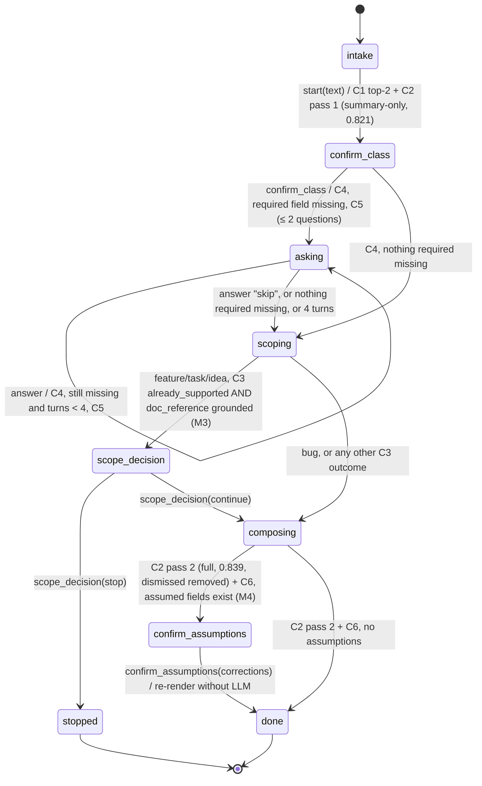

# 04 · Modeling

_One section per component (AGENTS.md). Decisions are logged in [`decisions.md`](decisions.md); evaluation rows are in [`05_evaluation.md`](05_evaluation.md)._

> **CRISP-DM iteration.** Phase 1 ([`01_business_understanding.md`](01_business_understanding.md)) was written **after** Phases 2–3 and the model bake-off ([`model_selection.md`](model_selection.md)). Its problem statement, targets and risks therefore rest on EDA and bake-off evidence. The success targets were then accepted with three changes (decision B1). Logged in the change log of `decisions.md`.

## Shared infrastructure
- **LLM calls:** only through `src/llm.py`. Models per role come from `config.yaml` (L2):
  - generator: `deepseek/deepseek-v4.1-flash-1017`, reasoning off, temperature 0;
  - judge: `google/gemini-3.5-flash-lite`;
  - simulator: `qwen/qwen3.5-27b`.
- **Prompts:** `src/prompts/<component>.md`, each with a `version` header, loaded by `src/prompting.py`.
- **I/O schemas:** pydantic models in `src/schemas/`. Ticket fields come from `src/schemas/ticket_types.yaml`.
- **Eval helpers:** `src/eval/metrics.py` (metrics, bootstrap CIs, Cohen's κ), `src/eval/samples.py` (named val/drift samples) and `src/eval/run_log.py` (cost, latency and budget from `logs/llm_calls.jsonl`).

## C1 · Classifier

**Purpose:** predict the ticket class (bug / feature / task / idea, decision D1) and the Spark component from the user's text. This selects the field schema for C4–C6 and pre-fills `component`.

**Input:** `C1Input{summary, description}` in one of two modes (B1):
- **full** = summary + first 1,500 characters of the description;
- **summary-only** = summary. This is a proxy for the vague first user message.

The targets apply to *full*; *summary-only* is reported for reference.

**Output:** `C1Output{rationale, class, component[1–3, most likely first], confidence ∈ [0, 1]}` (`src/schemas/c1.py`).
- Components are the top 15 of TRAIN plus `other`, which together cover 96% of train issues.
- An issue's gold set = its Jira components, mapped to these 16 labels.
- A top-k hit = any of the first k predicted components is in the gold set.

**Variants**

| | Baseline (`src/components/classifier_baseline.py`) | LLM (`src/components/classifier.py`) |
|---|---|---|
| Class model | TF-IDF word 1–2 + char_wb 3–5 → `LogisticRegression(class_weight="balanced")`; C tuned on val (macro-F1) | One call to the generator; class definitions from `ticket_types.yaml`; prompt `c1_classifier/v1` |
| Component | One-vs-rest LogisticRegression over the 16 labels, ranked by probability; C tuned on val (top-1) | Ranked list (1–3) in the same call |
| Context | Trained on TRAIN | **Dynamic few-shot**: the k nearest TRAIN issues **per class** (TF-IDF cosine); k ∈ {0, 2, 4} tuned on val |
| Model calls | 0 | 1 per ticket, schema-validated (`json_schema` mode), one repair retry |

**Choices and alternatives**
- **Few-shot from TRAIN, chosen per class.** This guarantees idea examples in every prompt; zero-shot never predicted idea correctly in the bake-off.
  - Alternative: k nearest overall. Rejected because idea is 1.1% of train, so it would almost never be shown.
- **k tuned on a 325-item val subset** (100 per class + all 25 idea; it mirrors `classification_test`). The smallest k within 0.01 macro-F1 of the best is chosen, because it is cheaper.
  - Alternative: the full val (2,249). Rejected: about 7× the cost for little gain in precision on the rare classes.
- **Baseline trained on TRAIN only**, even for the final run, so it is comparable with the LLM, whose examples come only from TRAIN.
  - Alternative: refit on train + val. Rejected: it changes what the test result measures.
- **Test and drift are evaluated once**, after approval of the val results. `eval/eval_c1.py` refuses to run them without `--confirm-test` and `eval/c1_final_config.json`, and refuses a second run.

### C1 val results (tuning; `eval/results/c1_val_20261115T135541Z.json`)

Val only; test has not been touched. LLM spend $0.22 (1,950 calls + smoke run $0.02). Confusion matrices: `reports/figures/c1_{baseline,llm}_{full,summary}_val.png`.

**Tuning**

| Variant | Mode | Grid (val macro-F1) | Chosen |
|---|---|---|---|
| Baseline | full | C 0.1: 0.530 · 0.3: 0.563 · **1: 0.567** · 3: 0.561 · 10: 0.558 (all val, n = 2,249) | C = 1; component C = 10 (top-1 0.738; plateau from C = 3) |
| Baseline | summary | C 0.1: 0.484 · **0.3: 0.491** · 1: 0.490 · 3: 0.483 · 10: 0.481 | C = 0.3; component C = 3 |
| LLM | full | k 0: 0.459 · **2: 0.523** · 4: 0.477 (n = 325) | k = 2 per class (8 examples) |
| LLM | summary | k 0: 0.470 · 2: 0.456 · **4: 0.482** | k = 4 per class (16 examples) |

The differences between values of k (≤ 0.064) are within the bootstrap CIs (about ±0.06), and they are not monotonic. Few-shot examples help a little at best.

**Both variants on the same 325 val items** (100 per class, all 25 idea)

| Variant · mode | Macro-F1 [95% CI] | Accuracy | Idea recall [CI] | P/R bug · feature · task · idea | Component top-1 / top-3 | Latency | Cost / 100 calls |
|---|---:|---:|---:|---|---:|---:|---:|
| **Baseline · full** | **0.561** [0.49–0.62] | 0.597 | 0.28 [0.12–0.47] | .67/.73 · .47/.67 · .71/.47 · .88/.28 | **0.73 / 0.93** | 0.3 ms | $0 |
| LLM · full (k = 2) | 0.523 [0.46–0.59] | 0.585 | 0.20 [0.07–0.37] | .73/.75 · .47/.46 · .56/.64 · .56/.20 | 0.72 / 0.81 | p50 1.0 s, p95 2.3 s | $0.015 |
| Baseline · summary | 0.512 [0.45–0.57] | 0.585 | 0.16 [0.03–0.32] | .63/.72 · .50/.59 · .66/.55 · .44/.16 | 0.70 / 0.93 | < 0.1 ms | $0 |
| LLM · summary (k = 4) | 0.482 [0.42–0.54] | 0.541 | 0.16 [0.04–0.32] | .73/.66 · .44/.49 · .50/.57 · .50/.16 | 0.67 / 0.79 | p50 1.0 s, p95 2.0 s | $0.011 |

- **The baseline is at least as good as the LLM** on every Jira-based metric, at zero cost and about 3,000× lower latency. The macro-F1 CIs overlap, so the gap (0.04) is not significant at n = 325.
- **Component:** top-1 is similar for both (0.72–0.73). Top-3 is clearly better for the baseline (0.93 vs 0.81), because the LLM returns a single component for 62% of items and three for only 2%, so its top-3 is mostly a top-1.
- **Summary-only** costs both variants about 0.05 macro-F1. The vague first message is harder, as expected.
- **Against the targets (B2: macro-F1 ≥ 0.37, idea recall ≥ 0.40; component top-1 ≥ 0.60, top-3 ≥ 0.85):** both variants meet macro-F1 and component top-1. Neither meets idea recall (0.28 / 0.20). Only the baseline meets component top-3.

**Human ceiling** (same 40 val items, mode full, Jira type hidden; decision B2)

| On the 40 items | Macro-F1 vs Jira | Accuracy vs Jira | Agreement with the user (κ) |
|---|---:|---:|---:|
| User (human) | 0.370 [0.21–0.50] | 0.35 | — |
| Baseline · full | 0.522 | 0.525 | 38% (κ 0.16) |
| LLM · full (k = 2) | 0.560 | 0.575 | 50% (κ 0.31) |

The user labelled 16 of 40 items *task*: 6 of 10 Jira features and 5 of 10 Jira bugs. Both models agree with Jira more than the user does, and the LLM agrees with the user more than the baseline does. This suggests the models (especially the baseline) partly learn Spark's **filing conventions**, while the user applies the **class definitions**. The C1 class targets were set to the human ceiling (B2).

**How to read C1's scores.**
- **Jira types encode Spark's filing conventions, not only our class definitions.** "Error" here partly means "did not imitate the convention".
- **The task is ambiguous even for a person** (human vs Jira: 0.37).
- **So in the product, C1 is a suggestion the user confirms** (M1), and its errors are cheap: one click in the UI, not a wrong ticket.

### C1 error analysis: 10 worst val errors (LLM · full · k = 2)

Wrong predictions ranked by the LLM's stated confidence, with idea↔feature and bug→task forced in. "Baseline" is the baseline's prediction for the same item.

| Key | Jira (type) | LLM (conf.) | Baseline | Hypothesis |
|---|---|---|---|---|
| SPARK-21785 | idea (Wish) | feature (0.95) | feature | A concrete request ("Support create table from a file schema", with SQL syntax) filed as a Wish. The LLM follows the definition; **label convention**: outside users file feature requests as Wish. |
| SPARK-11882 | idea (Wish) | feature (0.90) | idea | A concrete design (`spark.scheduler.factory.<name>`), filed as a Wish in 2015. The user also says *feature*. Convention again; the baseline gets it from old-Wish vocabulary. |
| SPARK-15504 | idea (Wish) | feature (0.90) | idea | Phrased as a question ("Could … support …?"), a typical Wish of the MLlib era. Question form + an old API is the baseline's cue; the LLM reads the request, not the tone. |
| SPARK-44212 | bug (Bug) | task (1.00) | bug | A dependency upgrade for a CVE, which the definition lists under *task*. Spark files CVE upgrades that break integrations as Bug. **Definition vs convention**; the confidence of 1.0 is overconfident. |
| SPARK-31050 | bug (Bug) | task (0.90) | task | "Disable flaky KafkaDelegationTokenSuite". Spark mostly files test failures as Bug, but its few-shot neighbours (flaky-test tickets labelled task) pushed it to task. **Inconsistent labels in TRAIN** also leak in through the examples. |
| SPARK-32006 | bug (Bug) | task (0.90) | feature | A performance regression against Spark 2.4, described as a refactor ("create formatters once"). **Genuine model error**: the guide says a performance regression is a bug, and the prompt's bug definition does not say so. |
| SPARK-38063 | task (Task) | feature (0.97) | feature | A new SQL function (`split_part`) with a specification, filed as a Task, likely as planned work under an umbrella. Both models say *feature*: **label convention** for planned work. |
| SPARK-38318 | task (Task) | bug (0.97) | bug | A clear regression ("works in 3.1, fails in 3.2"), filed as a Task. **Label noise**: both models say *bug*; the user said *feature*. |
| SPARK-34214 | task (Task) | feature (0.95) | feature | "Expose regexp_extract_all to PySpark", API-parity work filed as a Task. **Convention**: parity work is planned as Tasks. |
| SPARK-34552 | feature (Improvement) | bug (0.95) | bug | Inconsistent metadata between two catalog APIs. Genuinely **ambiguous** (bug or improvement); a committer chose Improvement. |

**Pattern:**
- 8 of the 10 "errors" are cases where the prediction follows the definitions and Jira follows Spark's filing conventions or contains noise.
- 1 is a genuine model error (performance regression), and 1 is ambiguous.
- The LLM states 0.90–1.00 confidence on all 10, so its **confidence is not calibrated** and must not be used as a routing threshold without calibration.

**Iteration considered and rejected: prompt v2 tuned to the errors.**
- **Proposal:** a `c1_classifier/v2` with Spark's conventions added to the class definitions, e.g. "flaky-test fixes and CVE upgrades are bugs", "planned API-parity work is a task", "concrete requests from users may be Wishes".
- **Rejected (2026-11-15, user decision):**
  - 8 of the 10 worst errors are Jira filing conventions, not misreadings of the text.
  - Tuning the prompt to imitate them would **overfit val**: the conventions are inconsistent even within TRAIN (flaky-test tickets are labelled both bug and task).
  - It would also **contradict our own class definitions**, which are what the user sees and confirms in the app.
- **Kept:** `c1_classifier/v1` and the definitions in `ticket_types.yaml` unchanged.
- **Not pursued now, for the same reason:** adding "a performance regression is a bug" (the one genuine error), and asking the LLM for exactly 3 components.

### C1 proposed final configurations (for test and drift, after approval)

| Variant | Mode full | Mode summary |
|---|---|---|
| Baseline | class C = 1, component C = 10 | class C = 0.3, component C = 3 |
| LLM (`c1_classifier/v1`) | k = 2 per class | k = 4 per class |

Approved by the user on 2026-11-15 and frozen in `eval/c1_final_config.json`.

### C1 pipeline decision (M1)
- **In the app, C1 = the baseline.** It is free, takes 0.3 ms, and has the best component top-3 (0.93), with macro-F1 equal to or better than the LLM.
- **The UI** shows the predicted class **plus the second most likely class** (from the class probabilities), and the user confirms one.
- **Components:** the top 3 are pre-filled for the user to confirm.
- **The LLM variant** remains the evaluated alternative. It has a rationale and agrees more with the human, but it is not used in the pipeline.

### C1 test and drift results (final configs, evaluated once)
Results: `eval/results/c1_test_20261115T140317Z.json` and `c1_drift_20261115T140546Z.json`.
- **Sets:** `classification_test.jsonl` (324: 100/100/100/24) and the drift slice (303: 100 per class + all 3 idea issues of 2026).
- **Spend:** LLM $0.18. Confusion matrices: `reports/figures/c1_*_{test,drift}.png`.

**Test (both variants on the same 324 items)**

| Variant · mode | Macro-F1 [95% CI] | Accuracy | Idea recall [CI] | P/R bug · feature · task · idea | Component top-1 / top-3 |
|---|---:|---:|---:|---|---:|
| Baseline · full (M1) | 0.542 [0.47–0.61] | 0.614 | 0.17 [0.04–0.32] | .66/.76 · .50/.72 · .78/.47 · 1.00/.17 | 0.73 / **0.94** |
| LLM · full (k = 2) | **0.571** [0.51–0.63] | 0.657 | 0.17 [0.04–0.33] | .72/.78 · .60/.58 · .65/.73 · .57/.17 | **0.76** / 0.86 |
| Baseline · summary | 0.509 [0.45–0.57] | 0.580 | 0.17 [0.03–0.31] | .63/.72 · .50/.59 · .65/.53 · .44/.17 | 0.72 / 0.95 |
| LLM · summary (k = 4) | 0.537 [0.48–0.60] | 0.645 | 0.08 [0.00–0.22] | .75/.69 · .58/.63 · .62/.75 · .50/.08 | 0.77 / 0.84 |

LLM cost and latency on test: $0.016 per 100 calls (full) / $0.012 (summary); p50 1.06 s, p95 1.9–2.2 s. Baseline: $0, under 1 ms.

**Drift 2026** (same 303 items). Macro-F1 over 4 classes is pulled down by idea, which has only 3 items, so the 3-class value is the meaningful one.

| Variant · mode | Macro-F1 (4 classes) | **Macro-F1 (bug/feature/task) [CI]** | Accuracy | Component top-1 / top-3 |
|---|---:|---:|---:|---:|
| Baseline · full | 0.472 | 0.632 [0.58–0.69] | 0.627 | 0.64 / 0.93 |
| LLM · full | 0.520 | **0.697** [0.65–0.74] | 0.693 | 0.71 / 0.84 |
| Baseline · summary | 0.507 | 0.680 [0.63–0.73] | 0.667 | 0.63 / 0.91 |
| LLM · summary | 0.444 | 0.595 [0.54–0.65] | 0.581 | 0.70 / 0.82 |

**Against the targets** (mode full, test; B2):

| Target | Baseline | LLM |
|---|---|---|
| Macro-F1 ≥ 0.37 | met (0.542) | met (0.571) |
| Idea recall ≥ 0.40 | **not met** (0.17, CI 0.04–0.32) | **not met** (0.17) |
| Component top-1 ≥ 0.60 | met (0.73) | met (0.76) |
| Component top-3 ≥ 0.85 | met (0.94) | met (0.86) |

**What changed from val, and why the decision stands**
- **The ranking flipped:** on val the baseline led (0.561 vs 0.523); on test the LLM leads (0.571 vs 0.542). Both gaps are within the CIs (n ≈ 325), so the two variants are **not distinguishable on class quality**.
- **Component:** the baseline keeps the clearly better top-3 (0.94 vs 0.86); the LLM has a slightly better top-1.
- **Drift 2026, mode full:** the LLM generalises better (3-class 0.70 vs 0.63; CIs overlap slightly). The baseline's component top-1 drops from 0.73 to 0.64, probably because the Connect / Rust-client vocabulary of 2026 is new to the TF-IDF model. In summary-only mode it is the other way round.
- **M1 stays as decided on val.** Changing the choice because of test results would be test-set selection. M1's reasons still hold: free, under 1 ms, best component top-3, and errors are cheap because the user confirms the class.
- **Recorded as a consideration for a later iteration, decided on val or a new drift slice and not on test:** an LLM fallback when the baseline is uncertain, which might help on new vocabulary such as 2026's.
- **Idea recall (0.17) misses its target in both variants.** With 24 idea items the CI is wide (0.04–0.33).
  - **The top-2 display (M1) helps, but only partly.** Baseline top-2 recall on test is bug 0.93, feature 0.96, task 0.87 and **idea 0.42** (top-1: 0.17), roughly the human ceiling (0.40). Still, 58% of idea tickets are not in the top 2.
  - **Implication for the UI:** besides the two suggestions, the user must be able to pick any of the four classes.

## C2 · Duplicate finder

**Purpose:** show likely existing SPARK issues while the user writes a ticket (goal 2), and raise a "possible duplicate" alert. No LLM calls.

**Input:** draft `summary` and `description`, in mode full (summary + first 1,500 characters of the description) or summary-only. **Output:** `C2Output{candidates: top-5 {key, summary, url, score}, alert, alert_score}` (`src/schemas/c2.py`).

**Retrieval** (`src/retrieval/`, corpus-agnostic, reused by C3):
- `bm25.py`: sparse-matrix Okapi BM25;
- `dense.py`: sentence-transformers on CPU, with each model's own prefixes and cached corpus embeddings;
- `hybrid.py`: RRF, k = 60, over the top 100 of each ranking;
- `text.py`: tokenizer and Jira-key masking.

The component is `src/components/duplicate_finder.py`.

**Corpus and time correctness:**
- Index = the main dataset (14,989 issues).
- For each query, only issues created **before** it are candidates, and never the query itself (unit-tested).
- **Jira keys** (`SPARK-123`, `HIVE-45`, …) are masked as `<ISSUE>` in queries and docs.
- BM25 IDF uses the whole corpus, a documented approximation; in the app every indexed issue is older than the draft.

**Evaluation sets** (`data/eval/duplicates.jsonl`; selection on **train + val only**):
- 113 duplicate queries; 84 non-duplicate queries.
- A hit = any gold issue (`gold_all`); MRR = MRR@100.
- Test (35 duplicate + 16 non-duplicate queries) is locked until approval.
- Results: `eval/results/c2_embedders_20261115T145110Z.json` and `c2_variants_20261115T145643Z.json`.

**Embedder (L3):**
- `BAAI/bge-small-en-v1.5`, dense MRR 0.632, ahead of all-MiniLM-L6-v2 (0.570) and e5-small-v2 (0.547).
- Also best in summary-only mode (0.536).
- Query p50 14 ms on CPU; corpus encoding 197 s once, then cached.

**Variants** (train + val, 113 duplicate queries; recall curves in `reports/figures/c2_recall_trainval.png`):

| Variant · mode | MRR [95% CI] | R@1 | R@5 | R@10 | Not in top 100 | Latency p50 / p95 |
|---|---:|---:|---:|---:|---:|---:|
| BM25 · full | 0.461 [0.38–0.54] | 0.37 | 0.56 | 0.69 | 16 | 1.1 / 1.6 ms |
| **dense · full** | **0.632** [0.55–0.71] | **0.56** | 0.72 | **0.79** | 11 | 11 / 35 ms |
| hybrid (RRF) · full | 0.569 [0.49–0.64] | 0.43 | **0.73** | 0.78 | 11 | 13 / 37 ms |
| BM25 · summary | 0.454 [0.38–0.54] | 0.36 | 0.58 | 0.65 | 17 | 0.8 / 1.0 ms |
| dense · summary | 0.536 [0.46–0.62] | 0.44 | 0.66 | 0.74 | 12 | 6 / 7 ms |
| hybrid · summary | 0.531 [0.45–0.61] | 0.42 | 0.67 | 0.75 | 10 | 7 / 8 ms |

- **Dense beats hybrid on MRR.** Hybrid matches dense at R@5 (0.73 vs 0.72) but loses at R@1 (0.43 vs 0.56): BM25 promotes lexically similar non-duplicates, such as other flaky-test tickets, to the top. MRR is the selection metric, so **dense** is chosen.
- **Summary-only** costs 0.10 MRR: a short first message finds fewer duplicates.
- **Targets (B1): met in mode full.** R@5 0.72 ≥ 0.60 and MRR 0.632 ≥ 0.45. False alarms ≤ 0.20 holds by construction of the threshold.

**Jira-key masking** (as requested):
- Only **7 of the 113** train+val duplicate queries cite a Jira key that their gold also cites.
- Sensitivity check: hybrid MRR in mode full is **0.571 with keys unmasked**, vs 0.569 masked.
- So the key shortcut is rare here, and masking costs nothing.

**Alert threshold:**
- **alert_score** = the dense cosine of the top-1 candidate.
- **Threshold:** the one that maximises alert recall subject to false alarms ≤ 0.20 on the 84 train+val non-duplicate queries, **chosen per mode**. Summary-only queries score lower cosines, so the full-mode threshold would leave summary-only with alert recall 0.27.

| Mode | Threshold | Alert recall | Alert precision* | False-alarm rate | Useful alert (alert + gold in top 5) |
|---|---:|---:|---:|---:|---:|
| full | 0.839 | 0.57 | 0.80 | 0.19 | 0.44 |
| summary | 0.821 | 0.40 | 0.75 | 0.18 | 0.34 |

\*The eval set is 57% duplicates, while real traffic is about 2% (EDA), so precision here is optimistic; the false-alarm rate is the operational number. In the app the top 5 are always shown; the alert only decides whether to highlight them.

### C2 error analysis: 10 worst misses (dense · full · train+val)
In all 10, the gold issue is not in the top 100 for any variant (except one where BM25 ranks it 58th).

| Query → gold | Hypothesis |
|---|---|
| SPARK-31928 "Flaky test: StreamingDeduplicationSuite…" → SPARK-31593 "Remove unnecessary streaming query progress update" | **Root-cause link, not the same text**: the flaky test is the symptom, the gold is the code change that caused it. Top-1 is another flaky-test ticket. |
| SPARK-32690 "Spark-32550 affects the performance of some cases" → SPARK-32550 | **A regression report about the gold change**, linked only through the cited key (written "Spark-32550"; the gold's own text never contains its key). A follow-up, not a duplicate. |
| SPARK-35108 "Pickle produces incorrect key labels for GenericRowWithSchema" → SPARK-34545 "PySpark Python UDF return inconsistent results…" | **Same root cause, different symptoms** (pickling vs UDF results); no shared wording. |
| SPARK-36440 "Spark3 fails to read hive table with mixed format" → SPARK-36197 "InputFormat of PartitionDesc is not respected" | **User symptom vs developer root-cause wording** ("mixed format" vs "PartitionDesc / InputFormat"). |
| SPARK-38218 "…wrong package on the downloads page… hadoop3.3 vs hadoop3.2" → SPARK-37445 "Update hadoop-profile" | **Terse task as gold** (one line). Top-1 SPARK-37068 "Confusing tgz filename for download" is plausibly an *unlinked* duplicate, so the label is incomplete. |
| SPARK-38514 "Download link on spark 3.2.1 for hadoop 3.2 is wrong" → SPARK-37445 | Same as above: same terse gold, and the same plausible unlinked top-1 (SPARK-37068). |
| SPARK-39551 "Add AQE invalid plan check" → SPARK-39447 "Only non-broadcast query stage can propagate empty relation" | **Gold has an empty description** and a narrow summary; the relation is "fixed by", not the same report. |
| SPARK-40706 "IllegalStateException when querying array values inside a nested struct" → SPARK-39854 "ColumnPruning … explode" | **Root-cause link.** Top-1 SPARK-37855 "IllegalStateException when transforming an array inside a nested struct" looks like an unlinked duplicate (**incomplete labels**). |
| SPARK-42049 "Improve AliasAwareOutputExpression" → SPARK-41793 "Incorrect result for window frames … large decimals" | **Likely a wrong or loose link:** no topical overlap. Top-1 SPARK-39397 "Relax AliasAwareOutputExpression…" is the topically right issue. |
| SPARK-44764 "Streaming Python process management improvement" → 3 tasks of the Spark Connect streaming-listener work | **Gold = sibling tasks under one umbrella**; the relation is "same project", not "same request". |

**Pattern:**
- Most misses are **relation links** (root cause, "fixed by", regression of, sibling tasks), not tickets that describe the same request. Text similarity cannot find them, and the user writing a new ticket would not know them.
- In 3 cases the top-1 is a plausible **unlinked duplicate**, so the measured recall is a lower bound.
- Not pursued: tuning on these cases would fit the link conventions, not duplicate detection.

### C2 proposed final configuration (for the one-time test run, after approval)

| Setting | Value |
|---|---|
| Variant | **dense** |
| Embedder | `BAAI/bge-small-en-v1.5` (L3) |
| Jira keys | masked |
| Alert threshold | full **0.839** · summary-only **0.821** (chosen on train+val) |

**Choices and alternatives:**
- **Hybrid** (the expected winner): rejected on MRR. It may be worth revisiting for C3 (documentation search), where exact identifiers such as config names matter more.
- **Re-ranking with an LLM:** out of scope (no LLM calls for C2).
- **One threshold for both modes:** rejected; summary-only alert recall would fall to 0.27.
Approved by the user on 2026-11-15 and frozen in `eval/c2_final_config.json`.

### C2 test results (final config, evaluated once; `eval/results/c2_test_20261115T145857Z.json`)
Dense · `BAAI/bge-small-en-v1.5` · Jira keys masked · per-mode thresholds from train+val.

| Mode | MRR [95% CI] | R@1 | R@5 | R@10 | Latency p50 | Alert recall | Alert precision | False alarms: 16 test queries | False alarms: all 100 |
|---|---:|---:|---:|---:|---:|---:|---:|---:|---:|
| full (0.839) | 0.604 [0.45–0.75] | 0.51 | **0.74** | 0.77 | 14 ms | 0.54 | 0.83 | **0.25** (4 / 16) | 0.20 |
| summary-only (0.821) | 0.469 [0.32–0.62] | 0.37 | 0.54 | 0.66 | 6 ms | 0.31 | 0.79 | 0.19 (3 / 16) | 0.18 |

- **Ranking generalises:** test MRR 0.604 (n = 35) vs 0.632 on train+val, with overlapping CIs. **R@5 0.74 ≥ 0.60** and **MRR 0.604 ≥ 0.45** (mode full): both targets met. In summary-only mode, R@5 is 0.54, below 0.60; summary-only is reported for reference.
- **False alarms, honestly:**
  - On the 16 untouched test non-duplicate queries: 0.25 (full), above the 0.20 target. One query moves this rate by 6 points (CI roughly 0.07–0.52).
  - On all 100 non-duplicate queries: 0.20 (full) / 0.18 (summary-only). This number is **optimistic**, because 84 of the 100 were used to choose the threshold.
  - Verdict: the false-alarm target is *borderline*. A stricter threshold would trade alert recall for fewer false alarms; it should be re-chosen only on new non-test data, not on test.
- **Pipeline:** decision M2 (below and in `decisions.md`).

### C2 pipeline decision (M2)
C2 runs **twice** in the dialogue:
1. **On the first user message**, in summary-only mode with threshold **0.821**: early warning before the user invests time.
2. **Before C6** (ticket composer), with the collected summary + description, in mode full with threshold **0.839**: a better-informed second check (MRR 0.604 vs 0.469 on test).

Candidates the user **dismissed** in the first pass are removed from the second pass, so the user is not asked twice about the same issue.

**Why a false-alarm rate of 0.20–0.25 is acceptable:**
- **The alert is non-blocking:** the user sees the candidates and can dismiss them with one click.
- **The two errors cost very different amounts:** a false alarm costs one click, while a missed duplicate costs a new Jira ticket that a committer has to triage and close as Duplicate.

## C3 · Scope checker

**Purpose:** before a feature, task or idea ticket is filed, tell the user whether Spark already does it, citing the Spark 4.3.0 docs (goal 3: route requests that need no ticket). **Docs-grounded by design:** the assistant must never claim `already_supported` without a citation, and it never answers from model knowledge (decisions.md, C3 label semantics).

**Input:** `summary` + the first 1,500 characters of the description (Jira keys masked). **Output:** `C3Output{rationale, verdict, cited_chunk_ids, explanation (≤ 2 sentences), doc_reference}` (`src/schemas/c3.py`). A validator requires `doc_reference` when the verdict is `already_supported`.

**Design** (`src/components/scope_checker.py`, prompt `src/prompts/c3_scope.md` v1):
- `DocIndex` over `data/processed/doc_chunks.jsonl`, reusing `src/retrieval` (BM25 / dense bge-small / hybrid RRF).
- One generator call (`deepseek/deepseek-v4.1-flash-1017`, temperature 0, reasoning off) with the top-k chunks and their ids.
- The four label definitions in the prompt are identical to the labelling guidelines (unit-tested).
- Prompt rule: if the excerpt that would show support is not among those given, say "the provided docs do not show …" and do not name an API from memory.

**Evaluation data and caveats:**
- **Labels:** the user's 80 scope labels, from a **single non-expert annotator**. They are split into dev 30 / test 50 (stratified, seed 42, frozen in `data/eval/scope_split.json`). All tuning is on dev; test runs once.
- **Label bias toward BM25:** the labels were made after seeing `label_cli`'s BM25 top 5, as 280-character previews. Two cases show the effect:
  - SPARK-33809 ("all columns except"): labelled `needs_development`; the `SELECT * EXCEPT` chunk (`sql-ref-syntax-qry-star#000`) was not among the 5 shown, and dense retrieval finds it;
  - SPARK-48643: labelled `needs_development` before `spark.sql.redaction.options.regex` was in the corpus.
  So hit@k is a **lower bound biased toward BM25**, and the labels themselves lean toward what BM25 showed.
- **Two subsets** (decisions.md):
  - **docs-evidenced** (a supporting chunk from labelling or from the evidence review, `data/eval/scope_evidence_added.jsonl`): the primary measure;
  - **knowledge-based** (no chunk): treated as **noisy labels**. Some `already_supported` labels there are educated guesses, not verified knowledge.
  - **Caveat on docs-evidenced:** "supporting chunk" was never defined in `label_cli`. In dev, none of the 12 docs-evidenced `already_supported` chunks states the requested capability (4 on-topic, 8 unrelated; `label_cli` reproduces all 80 stored top-5 lists, so this is what was shown). This subset therefore measures agreement with an annotator who found a related doc. It is the more reliable subset, not a clean gold standard.

### C3 retrieval (dev, final corpus of 2,932 chunks; `eval/results/c3_retrieval_20261115T154100Z.json`)

| Variant | hit@1 | hit@5 | hit@8 | relevance@5 (uncalibrated) | any-relevant@5 |
|---|---:|---:|---:|---:|---:|
| BM25 | 0.917 | 1.000 | 1.000 | 0.060 | 0.200 |
| **dense** | 0.000 | 0.167 | 0.250 | **0.080** | 0.233 |
| hybrid | 0.250 | 0.417 | 0.417 | 0.073 | 0.267 |

- hit@k uses the 12 dev items that had a supporting chunk at labelling time; BM25's 1.0 is circular (those chunks came from BM25's top 5).
- **Selection rule:** relevance@5, then hit@5. Dense was chosen on all three corpus versions.
- **Caveat:** the relevance judge failed calibration (κ −0.29, below), so the variant choice rests on an **uncalibrated proxy**.
- **Sensitivity check:** on corpus v2, BM25 verdict accuracy was 0.267 vs 0.300 for dense (`c3_verdict_20261115T151943Z.json`), so the choice does not drive the result.

### C3 corpus iterations (CRISP-DM, Data Preparation ↔ Modeling; decisions.md)

| Version | Corpus | Dev verdict run |
|---|---|---|
| v1 original | 2,034 Markdown chunks | `c3_verdict_20261115T151215Z.json` |
| v2 + reference lists | + 111 chunks: generated SQL function and SQL config tables, which the Markdown sources only include at build time | `c3_verdict_20261115T152008Z.json` |
| v3 + one-entry chunks | the reference as 898 one-entry chunks (`title > heading` + one line) | `c3_verdict_20261115T154133Z.json` |

The user fixed v3 as the **last** corpus iteration, with no further tuning on the 30 dev items. All three runs use dense retrieval and k = 8, chosen per version by dev accuracy (v3 k-grid: 3 → 0.333, 5 → 0.267, **8 → 0.367**).

**Accuracy by subset** (dev; `eval/results/c3_compare_20261115T161018Z.json`, evidence review included):

| Version | All (n=30) [95% CI] | Docs-evidenced (n=17) | Knowledge-based (n=13) | macro-F1 (all) |
|---|---:|---:|---:|---:|
| majority baseline | 0.533 | 0.706 | 0.538 | — |
| v1 original | 0.333 [0.17–0.50] | 0.235 | 0.462 | 0.243 |
| v2 + reference lists | 0.300 [0.17–0.47] | 0.176 | 0.462 | 0.218 |
| **v3 + one-entry chunks** | **0.367** [0.20–0.53] | **0.235** | **0.538** | **0.271** |

**Dev confusion matrices** (rows = label, columns = prediction: AS = already_supported, ND = needs_development, OOS = out_of_scope, II = insufficient_info; figures `reports/figures/c3_dev_v{1_original,2_reference_lists,3_one_entry}.png`):

| label ↓ | v1: AS | ND | OOS | II | v2: AS | ND | OOS | II | v3: AS | ND | OOS | II |
|---|---:|---:|---:|---:|---:|---:|---:|---:|---:|---:|---:|---:|
| AS (16) | 1 | 10 | 2 | 3 | 1 | 9 | 2 | 4 | **2** | 8 | 2 | 4 |
| ND (10) | 2 | 8 | 0 | 0 | 2 | 7 | 0 | 1 | 2 | **8** | 0 | 0 |
| OOS (3) | 0 | 2 | 0 | 1 | 0 | 3 | 0 | 0 | 0 | 3 | **0** | 0 |
| II (1) | 0 | 0 | 0 | 1 | 0 | 0 | 0 | 1 | 0 | 0 | 0 | **1** |

**Reading the iteration:**
- **What the corpus fix gained:** v3 gains two items over v2 (+0.067; the CIs overlap) and no class pattern changes.
- **Where it helped:** the gain is where the docs had the answer. SPARK-31008 (`json_array_length`) is now predicted `already_supported`, citing the one-entry chunk. SPARK-33466 (Imputer `mode`) is correct with a chunk the model found itself (`ml-features#035`), not the one the annotator chose.
- **The dominant error:** `already_supported` labels predicted as `needs_development` (8 of 16). For a docs-grounded system that cannot find the capability in the docs, this is the expected answer.
- **Why knowledge-based scores higher (0.538) than docs-evidenced (0.235):**
  - knowledge-based is mostly `needs_development` labels (7 of 13), which match the model's tendency to predict it;
  - on its 4 `already_supported` labels the model gets 0, which is correct behaviour for a docs-grounded system when the docs are silent.
  - The gap is **label semantics vs a docs-grounded system**, not retrieval quality.

**Other dev metrics (v3, k = 8):**
- `doc_reference` grounded in the retrieved chunks: **4 / 4 (1.0)**;
- invalid citations: 0.0;
- explanation ≤ 2 sentences: 0.967;
- items without a citation: 4;
- citation support: 0.182 (55 citations; **uncalibrated**);
- generator: $0.067 per 100 calls, p50 2.0 s, p95 5.4 s.

### C3 judge calibration (`eval/results/c3_judge_calibration_20261115T160918Z.json`; L2 update in decisions.md)

| Judge | n | κ human vs judge | Agreement | Repeat agreement (κ) | Status |
|---|---:|---:|---:|---:|---|
| citation support | 30 | −0.04 | 0.40 | 0.87 (0.68) | **uncalibrated** |
| chunk relevance | 14 | −0.29 | 0.36 | 0.93 (0.86) | **uncalibrated** |

- **Criterion mismatch, not judge noise.** The judge is self-consistent (repeat agreement 0.87 / 0.93).
  - On `already_supported` citations, annotator and judge agree on 4 of 5.
  - On "the docs do not show X" answers they agree on 8 of 25. The annotator counted the **closest related chunk** as support (18 yes); the judge required the chunk to **state the claim** (5 yes).
- **Adopted definition (user decision):** the judge's stricter reading is the one the product needs: no claim without evidence. It is the definition of "citation support" from now on.
- **What this means for the labels:** the annotator's labels used a looser criterion. That is a **limitation of the annotation**, and it applies to the supporting chunks and the relevance labels too.
- **κ values are kept as measured** (−0.04, −0.29). Judge-based numbers (citation support, relevance@5) stay **uncalibrated proxies**. No strong-tier judge (L2 fallback not applied).
- **Lesson, now a project rule (AGENTS.md):** future judge prompts and calibration CLIs show the same rubric with explicit edge cases: absence claims, partial support, paraphrase.

### C3 error analysis: all 19 dev errors (v3 · dense · k = 8)

Categories:
- **noisy label:** the docs do not support the label, and the verdict is consistent with the docs;
- **ambiguity:** both readings are defensible under the four definitions;
- **retrieval miss:** the corpus does not contain the needed doc;
- **reasoning:** the relevant chunk was present and the verdict is still wrong.

| Key · label → prediction | Category | Hypothesis |
|---|---|---|
| SPARK-29881 AS → ND | noisy label | Asks for a codegen "barrier" API. The evidence chunk is ML `Pipeline.transform` (word match); no such API is in the docs. |
| SPARK-30557 AS → II | noisy label | Asks to *document* `SPARK_SUBMIT_OPTS`; the variable is in no chunk. II ("docs do not show") is the docs-grounded answer. |
| SPARK-31142 AS → ND | noisy label | Internal PySpark cleanup. The evidence chunk is a GraphX/SparkR config table. |
| SPARK-31340 AS → ND | noisy label | Servlet filter `destroy()` on shutdown. The evidence chunk is the Structured Streaming quick example. |
| SPARK-33809 ND → AS | noisy label | The model cites `SELECT * EXCEPT (…)` (`sql-ref-syntax-qry-star#000`), which exists in 4.3.0. The label was made without seeing that chunk (BM25 bias). |
| SPARK-34950 AS → OOS | noisy label | Benchmark refresh in the repo; no evidence. *Secondary reasoning issue:* OOS is meant for third-party or other products, not repo maintenance. |
| SPARK-35154 AS → ND | noisy label | RpcEnv self-deadlock. The evidence is the streaming `Receiver.onStop`, a different component; the model notes this explicitly. |
| SPARK-35365 AS → II | noisy label | Asks about `spark.sql.analyzer.maxIterations`, which is not in the corpus (internal config). The evidence chunk is barrier-mode configs. |
| SPARK-35594 AS → II | noisy label | CI workflow cleanup. The evidence chunk is a Hive UDTF example. |
| SPARK-35910 AS → ND | noisy label | Internal shuffle optimisation (resolution Fixed); no doc can show it. |
| SPARK-39973 AS → ND | noisy label | Suppress an internal warning (resolution Fixed); no doc can show it. |
| SPARK-26008 OOS → ND | ambiguity | Expose the test clock in production: "contradicts the design" or "needs code". Both fit. |
| SPARK-31218 AS → ND | ambiguity | Users can `cache()` their own RDDs (the evidence chunk), but the request is about an internal RDD inside MLlib. |
| SPARK-35598 OOS → ND | ambiguity | Internal `RowMatrix` change, Won't Fix. ND ("reasonable, needs code") is defensible. |
| SPARK-35862 OOS → ND | ambiguity | UTC-only watermark formatting, Won't Fix. Declined ≠ out of scope. |
| SPARK-47090 AS → OOS | ambiguity | Skip a CI job on branch-3.4: none of the four labels fits a repo task. *Secondary reasoning issue:* OOS misapplied, as in SPARK-34950. |
| SPARK-48643 ND → AS | ambiguity | The model: "the regex is already configurable, so set a stricter one". The label: "changing the default needs code". The explanation states both. |
| SPARK-42732 AS → ND | retrieval miss | `getActiveSession` is in no chunk: method-level API reference (Scala/Python API docs) is not in the corpus. The evidence chunks show Spark Connect in general. |
| SPARK-46085 AS → II | retrieval miss | Same gap for `Dataset.groupingSets` in the Scala Connect client. |

**Counts:** noisy label 11, ambiguity 6, retrieval miss (corpus gap) 2, reasoning 0 as the primary cause (2 secondary: OOS applied to repo-maintenance tasks).

**3 worst examples:**
1. **SPARK-33809:** the system is right by the 4.3.0 docs and is scored wrong. This is the BM25 label bias in action.
2. **SPARK-42732:** a real feature that exists, missed because the corpus has no API reference. This is the one gap a docs-grounded system could close: add the Scala/PySpark API docs. Out of scope here, since the corpus is frozen by the user's decision.
3. **SPARK-47090:** a repository task labelled AS and predicted OOS. The four-label scheme has no slot for CI/repo work. In the planned flow C3 also runs for `task` tickets, so whether to skip C3 for repository tasks is an open pipeline decision, to be made with the orchestration (not tuned on dev).

**Not pursued:** prompt changes for the OOS-on-repo-tasks pattern (2 items). The user froze dev tuning after corpus v3, and 2 of 30 items would be overfitting.

### C3 final configuration (approved 2026-11-15, frozen in `eval/c3_final_config.json`)

| Setting | Value |
|---|---|
| Corpus | v3, 2,932 chunks (sha256 prefix `16f4452d3d17bc2c`) |
| Retrieval | **dense** `BAAI/bge-small-en-v1.5`, **k = 8** |
| Generator | `deepseek/deepseek-v4.1-flash-1017`, temperature 0, reasoning off (L2) |
| Prompt | `c3_scope/v1` |
| Reported on test | accuracy, macro-F1, per-class metrics and confusion matrix with bootstrap CIs, on all / docs-evidenced / knowledge-based; `doc_reference` grounding; citation support (marked uncalibrated) |

- **Targets (B1):** accuracy ≥ 0.65 is **not met on dev** (0.367, below the 0.533 majority baseline).
- **Expected on test:** the same picture. For the reasons above, the number mostly measures agreement with a non-expert annotator.
- **Safety property, met on dev:** every `already_supported` claim names a reference grounded in a retrieved chunk (4 / 4).
- **Precision of `already_supported` against the labels:** 0.50 (2 of 4). Of the other 2, SPARK-33809 is supported by the docs and SPARK-48643 is ambiguous.

### C3 test results (final config, evaluated once; `eval/results/c3_test_20261115T161845Z.json`)
Dense · k = 8 · corpus v3 (sha256 prefix checked against the config before the run) · `c3_scope/v1`.

| Subset | n | Accuracy [95% CI] | Majority | macro-F1 | `already_supported` claims | Precision of `already_supported` | `doc_reference` grounded |
|---|---:|---:|---:|---:|---:|---:|---:|
| all | 50 | 0.320 [0.20–0.46] | 0.520 | 0.223 | 8 | **0.625** (5/8) [0.25–0.88] | **8/8 (1.0)** |
| docs-evidenced | 25 | 0.200 [0.08–0.36] | 0.720 | 0.121 | 4 | 0.75 (3/4) | 4/4 |
| knowledge-based (noisy labels) | 25 | 0.440 [0.24–0.64] | 0.520 | 0.306 | 4 | 0.50 (2/4) | 4/4 |

The precision CI is a bootstrap over the 8 claims, seed 42.

**Test confusion matrix** (rows = label; one generation failure counted as wrong; figure `reports/figures/c3_test.png`):

| label ↓ | AS | ND | OOS | II | failed |
|---|---:|---:|---:|---:|---:|
| AS (26) | **5** | 13 | 0 | 8 | 0 |
| ND (18) | 1 | **10** | 2 | 4 | 1 |
| OOS (5) | 2 | 2 | **0** | 1 | 0 |
| II (1) | 0 | 0 | 0 | **1** | 0 |

**Reading:**
- **Accuracy is below the majority baseline, as on dev** (0.320 vs 0.367). The B1 target of 0.65 is **not met**.
- **Why:** `already_supported` labels are mostly answered `needs_development` or `insufficient_info` (21 of 26). Recall of `already_supported` is 0.19.
  - The label limitations above apply: single non-expert annotator, BM25-biased labels, loose "support" criterion.
  - The model predicts `insufficient_info` far more often on test than on dev: 14 of 50 vs 5 of 30. Under M3 it behaves like `needs_development`: the user continues to a ticket.
- **Key metric (M3), precision of `already_supported`: 0.625** (5 of 8), and **all 8 claims have a grounded `doc_reference`**. The 5 correct claims cite exactly the right doc:
  - `spark.sql.files.ignoreMissingFiles`;
  - `spark.sql.adaptive.coalescePartitions.parallelismFirst`, from the generated reference added in corpus iteration 1–2;
  - `spark-sql -S`;
  - `spark.master.rest.host`;
  - the REST API `/api/v1`.

**The 3 wrong `already_supported` claims (the costly error under M3):**

| Key · label | Claim | Hypothesis |
|---|---|---|
| SPARK-45939 · OOS | `transformWithState` | The SPIP asked for an "Arbitrary State API v2", which shipped in Spark 4.0. The claim is right by the 4.3.0 docs; the label judged the 2023 proposal. **Noisy label.** |
| SPARK-19469 · ND | `SparkSession.builder.remote` | Wants a PySpark client on a separate machine from the driver. Spark Connect does exactly this in 4.x. **Noisy / time-shifted label** (2017 ticket). |
| SPARK-32413 · OOS | "pyspark" | A "which tool should I use" support question. The answer is grounded (`EsInputFormat` is in `rdd-programming-guide#010`), but the reference is generic. **Label ambiguity**, and a **limitation of the grounding check**: a generic name like "pyspark" passes trivially. |

**Other observations:**
- By the 4.3.0 docs, 2 of the 3 wrong claims are defensible, so label-measured precision (0.625) is conservative.
- **Generation failure, SPARK-31302:** the model twice chose `already_supported` without a `doc_reference`, and the schema validator rejected it after one repair. Under M3 a failure means "no stop", so the user continues to a ticket; the label is ND, so that is the right outcome.
- **Cost:** generator $0.062 per 100 calls, p50 1.8 s, p95 5.2 s, 3 repairs; judge $0.034 per 100 calls. The citation-support rate of 0.376 is uncalibrated.
- **Not done after test:** no prompt or grounding-check change on the basis of test. A specificity rule for `doc_reference` (e.g. require an identifier, not a product name) is a candidate for a future iteration, to be judged on new data.

### C3 pipeline decision (M3)
**C3 is precision-oriented.**
- The assistant says "already supported" only when the verdict is `already_supported` **and** `doc_reference` is grounded in the retrieved chunks.
- Any other outcome lets the user continue to a ticket: another verdict, an ungrounded reference, or a generation failure.
- **Why precision:** a false `needs_development` costs one unnecessary ticket. A false `already_supported` wrongly stops the user. So **precision of `already_supported`** is the key C3 metric, and accuracy / macro-F1 are secondary.
- **Test numbers:** precision 0.625 on 8 claims, all grounded.

## Evaluation set for C4 and C5: ablation (decision E1, `data/eval/README.md`)
- **Source:** rich real tickets with the verbatim text of 1–2 required fields deleted.
  - dev = 58 val tickets, 303 items; test = the 60 simulator candidates, 301 items. Frozen, with a test hash.
  - Variants: `original`, `minus_<f>` / `minus_<f>_<g>`, `answered_<f>` (asked, the user gives the text back), `unknown_<f>` (asked, the user says they don't know).
- **Gold:** a generator extraction with verbatim quotes, located deterministically; the 10 spot-check extractions (`eval/results/gap_spotcheck_20261115T164526Z.md`) were reviewed by the assistant, not confirmed by the user: no quote assigned to the wrong field; 2 doubtful values (SPARK-33121 environment says "Java API" for Scala code in a ```java fence; SPARK-52965 environment quotes a sentence about the failure).
- **Rules (user decision):**
  - a field that loses part of its text through another field's deletion is left out of scoring for that variant (no half-deleted field is ever scored);
  - the title is never deleted.
- **Limitation, quantified below:** a deleted field can survive in the title, in another field's passage, or in text the extraction did not quote. So results on deleted fields are a **lower bound** for C4.

## C4 · Gap detector

**Purpose:** after every user turn, tell the dialogue which ticket fields are still missing, so that C5 asks only about those and C6 composes only from what the user actually gave.

**Input:** the conversation (user and assistant turns) and the ticket class. **Output:** for **every** field of the class (common + class-specific) a `FieldState{evidence, status, value}`, with status confirmed | assumed | missing | unknown (`src/schemas/c4.py`).

**Design** (`src/components/gap_detector.py`, prompt `src/prompts/c4_gap.md` v2):
- **One generator call.** The output model is built per class with `pydantic.create_model` and has exactly that class's fields, so a missing or extra field fails validation.
- **Status rubric with explicit edge cases** (the AGENTS rubric rule applied to a generator):
  - partial information counts as confirmed;
  - "I don't know" volunteered before anyone asked counts as missing;
  - `unknown` only after the assistant asked;
  - information only the assistant mentioned counts as missing.
- **`max_tokens` 3,000.**
- **v1 → v2 (smoke fix on 20 dev items, not the tuning revision):**
  - v1 copied whole stack traces into `value` and `evidence`; 3 of 20 outputs were cut off at the cap;
  - v1 left `evidence` empty for 20 confirmed fields, because the key had a default;
  - v2 makes all keys required with `evidence` first and asks for short quotes and one-sentence values. Result: 0 failures, grounding 1.0, half the cost.

### C4 dev results (`eval/results/c4_dev_20261115T165319Z.json`; 303 items, 1,226 scored class-field judgements)

| Metric | Value |
|---|---:|
| Missing-field F1, positive = "missing" [95% CI] | **0.825** [0.80–0.85] (P 0.946, R 0.731) |
| Same, positive = "missing + assumed" (not confirmed) | 0.867 [0.85–0.89] (P 0.878, R 0.856) |
| Recall on **natural gaps** (fields already missing in the real ticket, n = 501) | **0.912** (assumed 28, confirmed 16) |
| Recall on **deleted** fields (n = 173) | 0.208 (confirmed 81, assumed 56) |
| False-confirmed rate on deleted fields (upper bound, see below) | 0.468 (+ 0.324 marked assumed) |
| `answered_<f>`: field confirmed after the user's answer (n = 52) | 0.942 |
| `unknown_<f>`: field marked `unknown` (n = 52) | **0.981** |
| False-unknown rate (fields marked unknown with no "don't know" answer) | **0.000** |
| Confirmed values with grounded evidence | 0.989 |
| Failures; cost; latency | 0 of 303; $0.031 / 100 calls; p50 2.1 s, p95 4.8 s |

**Per class** (missing-F1): bug 0.849, feature 0.873, idea 0.692, task 0.829.

**Per field:**
- **Structured fields are near-perfect:** regression_since 0.99, workaround 0.99, design_reference 1.0, definition_of_done 0.98, open_questions 0.96, alternatives_considered 0.95, acceptance_criteria 0.91.
- **Narrative fields are low:** problem_hypothesis 0.00 (n = 21), proposed_behavior 0.00 (16), motivation 0.14 (13), actual_behavior 0.16 (23), environment 0.20 (9), goal 0.33 (15).
- **Those low supports are almost all deleted fields.** The narrative fields are the ones a ticket restates in several places, including the title.

### C4 error analysis (all dev errors, grouped)
1. **Deleted field still resolved (137 of 173): mostly gold leakage, partly over-reading.**
   - **Where C4's evidence comes from** (deterministic): another field's passage 58, text the extraction never quoted 45, the title 33, not found 1.
   - **Leakage examples:**
     - SPARK-33338 `minus_expected_behavior`: the title says "GROUP BY using literal map **should not fail**", which is the expected behaviour, and the title is never deleted;
     - SPARK-32764 `minus_steps_to_reproduce_actual_behavior`: the reproduction code also sits in the "2.4.6 result" block quoted for expected_behavior.
   - **Over-reading examples:**
     - SPARK-39474 `minus_problem_hypothesis` confirmed from the *proposed* API ("I'd like to do something like `df.write…options(optimize=True)`");
     - SPARK-33338 `minus_environment` confirmed from the *working* version 1.6.3, which is regression information, not the affected environment.
   - **These cannot be separated deterministically.** A prompt rule like "never use another field's passage" would fit the gold's artifacts (e.g. it would wrongly flag the SPARK-32764 code as missing), so the one allowed tuning revision was **not** spent on it.
2. **Natural gaps credited (44 of 501): over-reading.** 16 confirmed and 28 assumed, mostly inference from related information, as in group 1.
3. **False "missing" on gold-present fields (28):** acceptance_criteria 9, related_issues 8, scope 3, expected_impact 3, others 5. The **gold is looser than C4**: the extraction counted a commit link or a CI-run URL as related_issues (SPARK-34040, SPARK-36375) and an implied expectation as acceptance criteria (SPARK-41813). C4's stricter reading is arguably the right one.

**Product decision M4:** `assumed` fields are never accepted silently. C6 lists them under "Assumptions to confirm", and the UI asks the user to confirm or correct them. So C4 leaning toward `assumed` rather than `missing` is acceptable; the operational score is the "missing + assumed" view (F1 0.867). The costly error is `confirmed` on information that is gone, which the human audit (`python -m src.eval.c4_audit_cli`, 20 blind cases, stratified by evidence source) corrects for leakage. 0.468 remains the upper bound.

**3 worst examples:** SPARK-39474 (problem from the solution), SPARK-33338 environment (wrong version used as the environment), and SPARK-47208 `minus_proposed_behavior` (C4 confirmed the deleted field, so in chained mode no question is asked about it; in oracle mode C5 also returned no question for this item, the only empty turn).

## C5 · Question generator

**Purpose:** turn the missing fields into at most 2 concrete questions per turn.

**Input:** class, conversation, missing fields (required first, with YAML description and example), provided fields with values, and a do-not-ask list of `unknown` fields. **Output:** `C5Output{questions: [{target_field, question}]}`. The list is not capped in the schema, so "≤ 2" is measured; the pipeline shows the first 2.

**Design:** `src/components/question_generator.py`, prompt `c5_questions/v1`, one generator call, `max_tokens` 600. Only class fields are asked about: the summary comes from the first message and the component from C1. No prompt revision was needed.

### C5 dev results (`eval/results/c5_oracle_dev_20261115T165508Z.json`, `c5_chained_dev_20261115T165555Z.json`)

| Metric (first 2 questions) | Oracle (gold states) | Chained (C4 states) |
|---|---:|---:|
| Turns with C5 called (≥ 1 missing field) | 294 / 303 | 277 / 303 |
| ≤ 2 questions per turn | **1.000** | 1.000 |
| Targeting rate (target ∈ gold-missing **required**) | 0.767 [0.72–0.80] | 0.431 [0.38–0.48] |
| — targets that are gold-missing at all (required or optional) | **403 / 403** | — |
| Redundancy (target already provided) | **0.000** | 0.046 |
| Required-before-optional violations | **0.000** | 0.232 |
| Required coverage | **0.993** | 0.556 |
| Re-ask of `unknown` fields | **0.000** (n = 52) | **0.000** (n = 52) |
| Cost; latency | $0.014 / 100 calls; p50 0.95 s | $0.012 / 100 calls; p50 0.89 s |

**Reading:**
- **C5 itself is near-perfect.** In oracle mode every question targets a missing field. The 0.767 targeting rate counts only *required* fields, and the other 94 questions ask about missing *optional* fields after all required ones were covered.
- **The chained drop is C4's.** Of 326 gold-missing required fields:
  - C5 asked about 158;
  - of the 168 it did not ask about, C4 had marked **167** as assumed (76) or confirmed (91), and only 1 is a C5 miss.
  - The chained order "violations" come from the same cause: C4 reported only optional fields as missing, so C5 correctly asked about those.
- **Errors (all dev):** 2 coverage misses in oracle mode.
  - SPARK-32764 `minus_steps_to_reproduce_actual_behavior` asked only about steps (2 required fields missing, 1 question);
  - SPARK-47208 `minus_proposed_behavior` returned no question.
- **Clarity:** 20-question samples for the user are in `eval/results/c5_questions_sample_oracle_20261115T165508Z.md` and `…_chained_20261115T165555Z.md`.

### C4 leak audit (dev; `eval/results/c4_audit_20261115T170704Z.json`)
**Setup:** 20 of the 137 deleted fields that C4 resolved, stratified by evidence source (another field's passage 8, unquoted text 7, title 5), labelled **blind** by the user with the on-screen rubric (stated / only inferable / not there).

| Labels | Stated (y) | Only inferable (i) | Not there (n) |
|---|---:|---:|---:|
| C4 said confirmed (14) | 10 | 4 | 0 |
| C4 said assumed (6) | 4 | 2 | 0 |
| By source: other field's passage / unquoted text / title | 4 / 6 / 4 | 4 / 1 / 1 | 0 / 0 / 0 |

| Stratified estimate | Value [95% CI] |
|---|---:|
| Resolved deleted fields whose information is still **stated** (gold leakage) | **0.69** [0.49–0.85] |
| **Corrected false-confirmed rate** (confirmed while not stated) | **0.312** [0.21–0.38]; upper bound 0.468 |
| Resolved although the information is gone (not even inferable) | **0.00** (0 of 20) |

**Reading:**
- About two thirds of C4's apparent misses on deleted fields are leakage in the ablation gold.
- The real error is **confirming what is only inferable** (should be `assumed`), estimated at 0.31 of deleted fields.
- C4 never resolved a field whose information was gone.
- **Limitations:** n = 20, one annotator, a single label per case; the CI comes from a stratified bootstrap over strata of 5–8 cases. The C4-missing deleted fields (36) were not audited and are taken as not stated.

### C5 question clarity (user rating of 20 dev oracle questions, `eval/results/c5_questions_sample_oracle_20261115T165508Z.md`)
- **Rating:** mean **2.65** of 3 (13 rated 3, 7 rated 2, none rated 1).
- **Pattern in the 7 items rated 2:** long, compound questions with "e.g." lists, mostly about process fields (acceptance_criteria, definition_of_done, expected_impact, target_users), e.g. SPARK-30286 and SPARK-33928.
- **Hypothesis:** the YAML examples are pasted into the question as long lists. Not tuned, because the config was approved for test; a candidate for a later revision on new data (shorter questions, one example).

### C4 / C5 final configurations (approved 2026-11-15; `eval/c4_final_config.json`, `eval/c5_final_config.json`)
- C4: `c4_gap/v2`, role generator (`deepseek-v4.1-flash`, temperature 0, reasoning off), `max_tokens` 3,000.
- C5: `c5_questions/v1`, same model, `max_tokens` 600; evaluated in oracle and chained modes.
- The ablation test hash is checked before the run.

### C4 test results (evaluated once; `eval/results/c4_test_20261115T170923Z.json`; 301 items, 1,153 scored field judgements)

| Metric | Dev | **Test** |
|---|---:|---:|
| Missing-field F1, "missing" [95% CI] | 0.825 | **0.837** [0.81–0.86] (P 0.949, R 0.748) |
| Missing-field F1, "missing + assumed" (operational, M4) | 0.867 | **0.889** |
| Recall on natural gaps | 0.912 (n = 501) | **0.935** (n = 479; assumed 22, confirmed 9) |
| Recall on deleted fields | 0.208 (n = 173) | 0.214 (n = 168; assumed 72, confirmed 60) |
| False-confirmed on deleted fields (upper bound) | 0.468 (corrected 0.31) | 0.357 (not audited) |
| `answered` → confirmed / `unknown` detected / false-unknown | 0.942 / 0.981 / 0.000 | 0.941 / **1.000** / **0.000** |
| Confirmed values with grounded evidence | 0.989 | 0.988 |
| Failures; cost; latency | 0; $0.031 / 100; p50 2.1 s | 0; $0.031 / 100; p50 2.1 s, p95 4.2 s |

**Reading:**
- Per class on test (missing-F1): bug 0.882, feature 0.856, task 0.859, idea 0.647.
- **Test confirms dev.** Idea stays the weakest class: its fields (problem, users, impact) are narrative and restated throughout a ticket.
- **The dev audit applies only qualitatively to test.** The test false-confirmed rate (0.357) is an upper bound; its leakage was not audited.

### C5 test results (evaluated once; `eval/results/c5_oracle_test_20261115T171019Z.json`, `c5_chained_test_20261115T171107Z.json`)

| Metric (first 2 questions) | Oracle dev | **Oracle test** | Chained dev | **Chained test** |
|---|---:|---:|---:|---:|
| Turns with C5 called | 294 | 284 | 277 | 279 |
| ≤ 2 questions per turn | 1.000 | **1.000** | 1.000 | **1.000** |
| Targets that are gold-missing (any) | 403 / 403 | **393 / 393** | — | — |
| Targeting rate (gold-missing required) | 0.767 | 0.751 [0.71–0.80] | 0.431 | 0.414 [0.37–0.46] |
| Redundancy | 0.000 | **0.000** | 0.046 | 0.050 |
| Required-before-optional violations | 0.000 | **0.000** | 0.232 | 0.225 |
| Required coverage | 0.993 | **1.000** | 0.556 | 0.544 |
| Re-ask of `unknown` fields | 0.000 | **0.000** (n = 51) | 0.000 | **0.000** (n = 51) |

**Reading:**
- **C5 alone is reliable on test.** Every question targets a missing field, no question repeats given information, and nothing the user said they don't know is asked again.
- **The chained losses are C4's, as on dev.** Of the gold-missing required fields C5 did not ask about on test, 155 of 159 were marked assumed (91) or confirmed (64) by C4.
- **Under M4, the assumed ones still reach the user** as "Assumptions to confirm". So the end-to-end gap is the confirmed-but-only-inferable case quantified by the audit.

## C6 · Ticket composer

**Purpose:** turn the collected field states into a Jira-ready ticket that follows the Spark contributing guide and never invents details.

**Input:** class, the confirmed component, C4 field states, the conversation. **Output:** `C6Output{title, jira_type, component, labels, body_markdown, fields}` (`src/schemas/c6.py`).

**Design:** the LLM writes the text, and code enforces the rules (`src/components/ticket_composer.py`, prompt `c6_compose/v1`, `max_tokens` 2,000).
- **LLM** (one generator call), producing a `C6Draft`:
  - the title, the labels (`correctness` / `data-loss` only if stated), and one text per field;
  - Given/When/Then for feature acceptance criteria and task definition of done;
  - prompt rubric: never invent versions, numbers, stack traces, config keys or APIs; never set priority or fix version; a descriptive title, with vague titles listed as negative examples.
- **Code, `render()`** (deterministic):
  - `jira_type` = `submit_as` from `ticket_types.yaml`, and the confirmed component;
  - `unknown` → "Unknown (reporter)"; required `missing` → "_Not provided_" (optional missing fields are omitted);
  - every `assumed` field is listed under **"Assumptions to confirm"** (M4);
  - a fixed template with no priority or fix-version line.
- **Why split it:** the hard rules hold by construction and are still measured, as regression checks.
- **Alternative rejected:** the LLM writing the whole body. That would make the format, the Unknown rendering and the assumptions list depend on the prompt.

### C6 dev results (`eval/results/c6_dev_20261115T172323Z.json`; 303 ablation items with the C4 dev states; deterministic metrics)

| Metric | Dev |
|---|---:|
| Schema-valid | **1.000** (303 / 303) |
| Required-field coverage (content or "Unknown (reporter)") | 0.766. Of the fields C4 resolved: **1.000**. The rest are missing by construction (deleted fields) |
| Missing fields filled with content | **0** |
| Confirmed values grounded (content-word share ≥ 0.6 or a verbatim C4 quote) | **0.876** [0.85–0.90] (n = 606) |
| Assumed values grounded (inference, listed for confirmation) | 0.541 [0.48–0.61] (n = 229) |
| Invented-token rate (title + confirmed fields) | **0.017**; tickets with ≥ 1: 0.079 [0.05–0.11] |
| Assumptions-section completeness / Unknown rendered | 1.000 / 1.000 |
| Given/When/Then in acceptance criteria / definition of done | 1.000 |
| Labels without a cue / priority or fix-version lines | 10 (see below) / **0** |
| Title 4–20 words and not the reporter's first line | 0.993 |
| Cost; latency | $0.030 / 100 calls; p50 1.5 s, p95 2.8 s; 0 repairs |

**Metric fix before the dev run** (smoke on 20 items; a measurement fix, not tuning):
- The first invented-token check flagged 14% of tokens:
  - it included the **assumed** fields, which carry C4's inference on purpose (M4);
  - unbalanced backticks around code fences paired prose fragments into "tokens";
  - it flagged generic Spark nouns ("DataFrame").
- **After the fix:** the check covers the title and the confirmed fields; it strips fence markers; backticked tokens have no whitespace; there is a short generic-noun list.
- Grounding is now reported separately for confirmed and assumed values. Logged in `decisions.md`.

### C6 error analysis (dev, all errors)
1. **Invented tokens: 19 distinct (ticket, token) pairs over 10 tickets.**
   - **Reformatting of the user's own text (11):** e.g. `sc.addFile()` for "sparkcontext.addfile()", `spark.files.overwrite=true` for `('spark.files.overwrite', 'true')`, `JdbcUtils.getCatalystType` from separate mentions.
   - **Inherited from C4 values (6, 4 tickets):** C4 had already put them in a field value. Examples: SPARK-31462's suggested getopts fix `"b:n"` as expected behaviour; a "DoS" CVE description (SPARK-49897).
   - **Invented by C6 (2):** "Scala 2.12.5" in SPARK-33997's environment, and "IEEE 754" in SPARK-32764's expected behaviour.
2. **Ungrounded confirmed values (12.4%):** concentrated in narrative idea/feature fields (problem_hypothesis 13, target_users 9, motivation 7, goal 7, expected_impact 6).
   - **Hypothesis: paraphrase, not invention.** The rewrite lowers the content-word overlap, while the invented-token rate stays low in those tickets.
3. **Labels without a cue (10):**
   - 7 are SPARK-32764 variants ("-0.0 < 0.0 returns true … should be false"): a wrong result, so `correctness` is **right**, and the cue regex is too narrow.
   - **3 are wrong labels:** SPARK-52965 (connection terminated), SPARK-34378 (Avro validation), SPARK-45126 (history server mixes tenant logs).
4. **Title (2):** the title equals the reporter's already-descriptive summary (SPARK-34378, SPARK-53182). That's metric strictness, not an error.

**3 worst examples:**
- **SPARK-33997:** the invented "Scala 2.12.5" is the costly kind, a wrong version in a bug report.
- **SPARK-52965:** `correctness` on a connection failure would mislabel the Jira issue.
- **SPARK-31462:** C4's suggested fix rendered as confirmed expected behaviour. Inference passed through the C4 → C6 chain; the M4 confirmation step does not catch it, because C4 called it confirmed.

**No prompt revision.** The C6-owned inventions are 2 in 303 tickets and the wrong labels 3 in 303: no systematic pattern.

## Pipeline (`src/pipeline.py`, decisions M1–M4)

The pipeline is an explicit state machine; the session state (`src/schemas/pipeline.py`) is JSON-serializable. Each user action runs the automatic steps up to the next user input. Every step is a `TraceEvent` (latency; LLM cost and cache state from `logs/llm_calls.jsonl` via `llm.session_calls`), and it is logged with the session_id.



**Design choices:**
- **Questions continue only while a *required* field is missing.** Optional fields are asked about only alongside a required one (C5's second question), so they never cost an extra turn.
- **"skip"** goes straight to the scope and compose steps, without another C4 call: the conversation has not changed since the last one.
- **Confirming assumptions** turns every assumed field into confirmed (as is, or with the correction, which is also added to the conversation). The ticket is **re-rendered deterministically** (`render()`), with no second LLM call, so the rest of the ticket does not change.
- **Graceful failure:** any exception in a step is caught. The trace records the error; `last_error` is set; the stage is kept; `retry()` reruns the segment (an unchanged LLM call is a cache hit). The app shows "This step failed (…). Try again, or type skip." and a Retry button.
- **C1 in the app:** the top-2 classes come with probabilities. The component is pre-filled with C1's top-1, and the top 3 are shown as suggestions (a refinement of M1, logged).
- **M6 (UX, from the user's manual run):**
  - C2 pass 1 is shown as "related issues" and never alerts; only pass 2 may.
  - The confirmed component always overrides C4's.
  - A missing optional field is "not provided", not "missing"; `labels` is hidden unless set.
  - The 🐞 title icon.
- **Headless driver** (`src/pipeline_driver.py`) for the e2e evaluation: a fixed policy (top-1 class and component, dismiss nothing, continue on the scope stop, accept the assumptions) and `answer_fn` for the simulated user.

**Verification:**
- `tests/test_pipeline.py` (9 tests, mocked components): every transition, the 4-turn cap, skip, the M3 stop only when grounded, dismissed keys excluded from pass 2, assumption correction, failure and retry, a JSON round trip, and the driver.
- Two real headless dialogues (bug and feature) and a scripted UI walkthrough (`streamlit.testing.AppTest`) reached `done` without exceptions:
  - session cost about $0.001;
  - per step: C4 about 2–3 s, C5 about 2 s, C6 about 1.8 s, C2 50–200 ms, C1 under 10 ms;
  - first app start about 25 s (C1 fit and embedder load).
