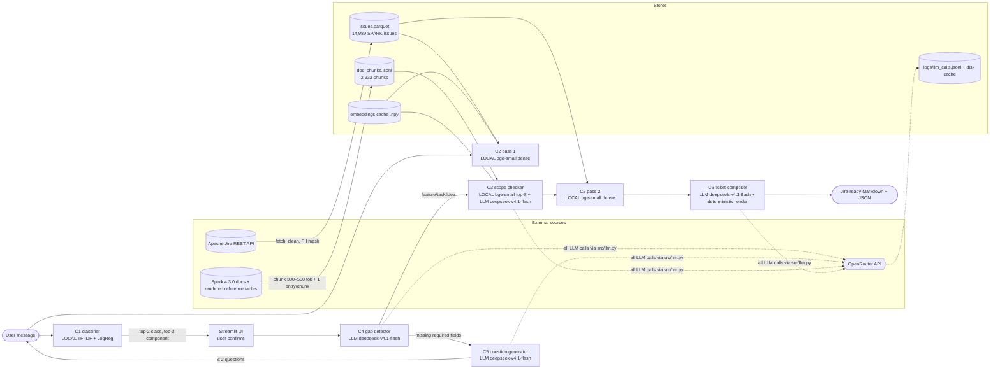
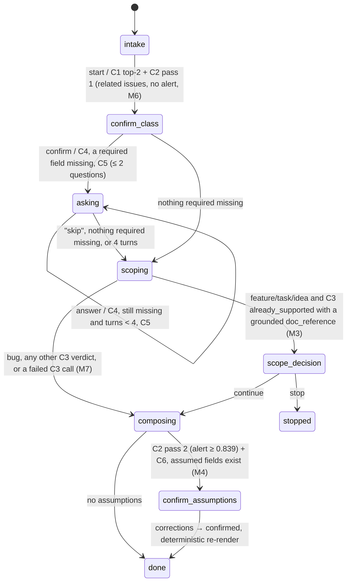

# Ticket Intake Assistant for Apache Spark — Final Report

UCU NLP course, Assignment 1 · CRISP-DM · code at `main` (`087297a`) · all numbers link to `reports/0*_*.md`,
`reports/decisions.md` and `eval/results/*.json`.

## 1. Task and scope

- **Problem:** Spark receives about 3.5–4.7k Jira issues a year, and most fall short of the contributing guide (`01_business_understanding.md`):
  - only **3.4%** of bug descriptions contain all four elements (reproduction, expected, actual, version/environment);
  - **36.7%** of issues have an empty description;
  - 16% of resolved bugs are closed as Incomplete, Duplicate, Invalid, Not A Problem, Cannot Reproduce or Won't Fix.
- **What the system does:** a chat assistant turns a vague request ("Spark crashes when…", "it would be nice if…") into a Jira-ready ticket of one of four classes (bug, feature, task, idea).
  - It checks for **duplicates**, asks **at most 2 questions per turn** (at most 4 turns), and checks against the docs whether the request is **already supported**.
  - It never invents facts: anything inferred is listed as an assumption for the user to confirm.
- **Out of scope:**
  - writing to Jira (the output is Markdown + JSON to paste);
  - other ASF projects; non-English tickets;
  - fixing bugs.

## 2. Data

| Source | Content | Use |
|---|---|---|
| Apache Jira REST API (`src/data/fetch_jira.py`) | 31,290 SPARK issues created 2020-01-01 … 2026-11-15 + 158 SPARK Wishes since 2014 | C1, C2, the eval sets |
| Spark 4.3.0 docs (`fetch_docs.py`, `fetch_doc_tables.py`) | 245 Markdown pages + the rendered SQL function / config tables → **2,932 chunks** | C3 (RAG) |

**Key EDA numbers** (`02_data_understanding.md`, `notebooks/eda.ipynb`):
- **Classes are very imbalanced** (core types): bug 6,994 · feature 9,144 · task 996 · idea 45. Sub-task is 39% of SPARK.
- **Bug structure:** 14% of bugs use reproduce wording, 19% state the expected behaviour, 21% the actual behaviour; 3.4% have all four elements. 49% show a code block and 42% a stack trace.
- **Duplicates:** 484 duplicate pairs; the link direction agrees with the resolution for 76% of the duplicates.
- **2026 is a drift:** bug filings jumped from about 60 a month to 530 in the first half of November, with templated, PR-linked tickets.
- **PII** is rare (user mentions in 0.4% of descriptions, e-mails in 0.1%) and is masked.

**Decisions D1–D5** (`decisions.md`):

| | Decision |
|---|---|
| **D1** | Class mapping: bug = Bug; feature = New Feature / Improvement / Story; task = Task / Test / Documentation / Dependency upgrade; idea = Wish / Brainstorming. Sub-task excluded. |
| **D2** | idea = SPARK Wish (all-time) + Brainstorming. Wishes from other projects are not used, because they reveal their project (63% name it). |
| **D3** | Main set = created before 2026 → **14,989 issues** (bug 5,419 · feature 7,624 · task 1,784 · idea 162). All of 2026 is a **drift set** (3,567). |
| **D4** | No resampling; stratified, Duplicate-group-aware 70/15/15 split (**frozen**, test hash `339455ee…`); macro-F1; class weights allowed. |
| **D5** | E-mails → `<EMAIL>`, Jira/@user mentions → `<USER>`, URL credentials removed. Jira wiki markup → Markdown, with code protected (`src/data/clean.py`). |

**Eval sets** (`data/eval/`, all frozen):

| Set | Size | Used for |
|---|---|---|
| `classification_test` | 324 | C1 |
| `duplicates` | 148 duplicate + 100 non-duplicate queries; the later issue is the query, the earlier the gold | C2 |
| `scope_labeled` | 80, labelled manually by the user; split dev 30 / test 50 | C3 |
| `gap_ablation` | 303 dev / 301 test items | C4–C6 |
| `simulator_candidates` | 60 | end-to-end |

## 3. Architecture

### (a) Data flow through C1–C6

- **Evaluation-only models:** judge `google/gemini-3.5-flash-lite` (C3 judges); simulator `qwen/qwen3.5-27b` (end-to-end). Neither is used by the app.
- **Infrastructure:** every LLM call goes through `src/llm.py` (disk cache, retries, structured output with one repair, call log, Langfuse if keys are set).

### (b) Pipeline state machine (`src/pipeline.py`, no agent framework)

- **State:** JSON-serializable.
- **Trace:** every step is a `TraceEvent` (latency; LLM cost and cache state from the call log). It is visible in the app's "Trace" expander.
- **Failures:** a failed step is recorded and can be retried, and the session is kept.

## 4. Components

| | Purpose | Input → output | Model / tool | Eval set | Metric | Result (test) vs target |
|---|---|---|---|---|---|---|
| **C1** | Ticket type + component, confirmed by the user (M1) | text → top-2 classes, top-3 components | TF-IDF (word + char) + LogReg; LLM few-shot evaluated as the alternative | classification_test (324) | macro-F1 · idea recall · component top-1/3 | 0.542 ✅ (≥ 0.37) · 0.17 ❌ (≥ 0.40; top-2: 0.42) · 0.73 / 0.94 ✅ |
| **C2** | Show existing SPARK issues; non-blocking alert (M2, M6) | draft → top-5 issues + alert | dense `BAAI/bge-small-en-v1.5`, Jira keys masked | duplicates test (35 + 16) | R@5 · MRR · false alarms | 0.74 ✅ · 0.604 ✅ · 0.25 ❌ (≤ 0.20; borderline) |
| **C3** | "Already supported?" with a cited doc (M3) | request → verdict + cited chunks + doc_reference | dense top-8 chunks + generator | scope test (50, single user) | precision of `already_supported` (key, M3) · accuracy | 0.625 (5/8, all grounded) · 0.320 ❌ (≥ 0.65; majority 0.52) |
| **C4** | Field status: confirmed / assumed / missing / unknown | conversation + class → states with evidence | generator, `c4_gap/v2` | ablation test (301) | missing-field F1 (missing / missing + assumed) | 0.837 / **0.889**; natural-gap recall 0.935; `unknown` detected 1.00 |
| **C5** | ≤ 2 targeted questions | missing fields + context → questions | generator, `c5_questions/v1` | ablation test (oracle / chained) | ≤ 2 per turn · targets missing · re-ask of "unknown" | 1.00 ✅ · 393 / 393 ✅ · 0 ✅; chained coverage 0.54 (C4's misses) |
| **C6** | Jira-ready ticket, no invention | states + conversation → title, body, fields JSON | generator writes text; code renders the rules | ablation test (301) | schema · grounding · invented tokens · rule checks | 1.00 ✅ · 0.913 · 0.003 ✅ · Unknown / assumptions / no priority 1.00 ✅ |

## 5. Walkthrough: one real app session (the user's manual run, session `43e35408b110`, 17:56 UTC)
**Sources:**
- per-call latency, tokens and cost from `logs/llm_calls.jsonl`;
- the exact messages and outputs from the request cache (`.cache/llm/`);
- C1 and C2 are not LLM calls and are not persisted, so they were **recomputed deterministically** on the same inputs (same results by construction).

The session ran before the M6 fixes.

| # | Step | What happened | Time | Cost |
|---|---|---|---:|---:|
| 1 | User | "Spark job fails when I read a big parquet folder" | | |
| 2 | **C1** (local) | bug 0.83 · task 0.08; components SQL, Spark Core, other → the user confirmed **bug · SQL** | 9 ms | $0 |
| 3 | **C2 pass 1** (local) | top-1 SPARK-12677 "Lazy file discovery for parquet", cosine 0.829 ≥ 0.821. **Alert raised on an unrelated issue**, which motivated M6 (pass 1 now never alerts) | 187 ms | $0 |
| 4 | **C4** | summary confirmed; actual behaviour "confirmed" from "fails" alone; steps, expected and environment missing | 1.9 s | $0.00022 |
| 5 | **C5** | Q1 steps_to_reproduce (minimal code), Q2 environment (version, API, deployment) | 1.3 s | $0.00012 |
| 6 | User | `spark.read.parquet("s3://bucket/events/").groupBy("user_id").count().show()` — "executor dies with java.lang.OutOfMemoryError: Java heap space. Spark 4.0.1, PySpark, on Kubernetes" | | |
| 7 | **C4** | steps, actual, environment confirmed (quoted evidence); expected missing | 2.4 s | $0.00029 |
| 8 | **C5** | Q: expected behaviour (did it work in a previous version?) | 1.0 s | $0.00014 |
| 9 | User | "It should just return the count per user. The same job worked fine on Spark 3.5.1 last month." | | |
| 10 | **C4** | expected + **regression_since** confirmed (optional, volunteered); component "assumed" SQL (M6 now overrides it with the confirmed value) | 1.6 s | $0.00028 |
| 11 | **C2 pass 2** (local) | top-1 SPARK-32277 "Memory limit exception on high usage of direct buffer pool" 0.844 ≥ 0.839 → alert; also SPARK-44718 "High on-heap memory usage … parquet-file reading" | 20 ms | $0 |
| 12 | **C6** | Title **"Executor OOM on groupBy().count() over large parquet folder in Spark 4.0.1"**, Bug · SQL; sections steps (code fence), expected, actual (error fence), environment, regression; no labels; no priority | 0.9 s | $0.00014 |

- **Totals:** 3 typed user turns, 2 question rounds, 6 LLM calls, about 9 s of system time, **$0.0012**.
- **Every rendered fact is in the user's messages.** The C6 invented-token check finds none.
- **How it compares:** all four bug elements are present, the case only 3.4% of historical SPARK bugs reach.

## 6. CRISP-DM mapping and iterations

| Phase | Artefacts | Iterations (logged in both phases + `decisions.md`) |
|---|---|---|
| 1 Business | `01_business_understanding.md`, `ticket_types.yaml` | **Written after Phases 2–3 and the model bake-off**, so the targets use EDA numbers. C1 targets lowered to the human ceiling (B2). |
| 2 Data understanding | `02_data_sanity.md`, `02_data_understanding.md`, `eda.ipynb` | — |
| 3 Data preparation | `03_data_preparation.md`, `src/data/*`, frozen splits and eval sets | **Doc corpus bug found in C3 modelling:** the generated SQL function / config tables were missing (iteration 1, +111 chunks); **one-entry chunks** (iteration 2, 898 chunks; the user declared it the last). The ablation set (E1) was built during C4 work. |
| 4 Modeling | `04_modeling.md` (C1–C6, pipeline, e2e) | **C4 `v1 → v2`** (a smoke fix: stack traces copied, evidence omitted); **extraction `v1 → v2`** (23% → 0% failures); **simulator `sim_user v1 → v2`** ("my ticket" mentions); metric fixes after smoke runs (C6 invented tokens, simulator checks). |
| 5 Evaluation | `05_evaluation.md`, `eval/results/*.json` | Test **once** per component with an approved `*_final_config.json` (lock); judge calibration; C4 leak audit; **M7 post-test fix** with a separately labelled rerun. |
| 6 Deployment | `README.md`, `app/streamlit_app.py` | M6 UX fixes from the user's manual run. |

**Product decisions:**

| | Decision |
|---|---|
| **M1** | C1 = baseline; the user confirms the type from the top-2. |
| **M2** | C2 runs twice; the alert is non-blocking (a false alarm costs a click, a missed duplicate a ticket). |
| **M3** | C3 is precision-oriented: "already supported" is shown only with a grounded doc_reference. |
| **M4** | Assumed fields are never accepted silently ("Assumptions to confirm"). |
| **M5** | C6: the LLM writes text, code enforces the rules; questions only for required fields. |
| **M6** | UX fixes: pass 1 without alert; the confirmed component wins; "not provided" for optional fields. |
| **M7** | A failed C3 call continues to the ticket. |

## 7. Evaluation summary

**End-to-end** (60 hidden test tickets, simulated user, `e2e_test_20261115T181923Z.json`):

| Metric | auto (C1 picks) | **corrects (user picks the type)** | Target |
|---|---:|---:|---:|
| Required-field recovery | 0.458 | **0.954** [0.91–0.99] | ≥ 0.90 ✅ |
| Facts not in the hidden ticket | 3.3% | **1.5%** | ≤ 5% ✅ |
| Typed user turns | 2.4 | **2.3** | ≤ 4 ✅ |
| Bug tickets with all 4 elements | 0.53 | **0.80** (history 3.4%) | ≥ 0.90 ❌ |
| Content-word recall vs gold (lexical) | 0.45 | 0.43 | ≥ 0.80 ❌ |
| Cost / p95 latency per turn | **$0.0013 / 6.9 s** | — | ≤ $0.01 / 8 s ✅ |
| Completion | 0.983 | 0.983 (2 / 2 after M7, post-test, labelled) | — |

**References and calibration:**
- **Human ceiling (C1):** the user, labelling 40 val issues without the Jira type, scored macro-F1 **0.37** against Jira; both models scored higher (0.52–0.56). Jira types encode filing conventions, so C1 is a suggestion the user confirms.
- **Judge calibration (C3):**
  - both judges failed: citation κ **−0.04**, relevance κ **−0.29**, while repeat consistency was 0.87 / 0.93;
  - this is a criterion mismatch, not noise; the judge's stricter reading was adopted as the definition;
  - after that, **all C4–C6 and e2e metrics are deterministic**, plus human audits.
- **C4 leak audit (human, blind, 20 cases):** 69% of C4's "misses" on deleted fields are gold leakage. The corrected false-confirmed rate is **0.31** [0.21–0.38], down from the 0.47 upper bound.

**Why the scores are not higher:**
1. **Label noise and conventions.** C1 is evaluated against Jira types, and a careful human agrees with them 35% of the time. The C3 labels come from one non-expert annotator. Inside its docs-evidenced subset, the "supporting" chunks are topical, not evidence: 0 of 12 state the capability.
2. **Docs-grounded by design.** C3 may not claim "supported" without a citation; method-level API docs are not in the corpus; many labels describe internal developer changes.
3. **Short openers.** C1 sees a single vague sentence in the app (top-1 0.43 in e2e). The UI asks the user to confirm for exactly this reason.
4. **Gold leakage and lexical metrics.** Deleted fields survive in titles and code blocks (ablation); recall has no stemming or synonyms; the simulator under-answers (5 of the 6 corrects misses).

## 8. Limitations
- **Single non-expert annotator** for the scope labels, the calibration pairs, the C4 audit and the C5 clarity ratings (2.65/3): no inter-annotator agreement.
- **Circular gold:** the ablation gold and the e2e gold come from extractions by the same generator family that C4/C6 use (mitigated by verbatim quotes, deterministic span checks and a review of 10 extractions by the assistant).
- **LLM simulator:**
  - it answers "don't know" too often when the information exists, and occasionally implies or invents (1 dialogue);
  - its first message is synthetic;
  - the hidden test tickets are in C2's corpus (95% self-matches), so the e2e duplicate-alert rate is not a false-alarm rate.
- **Jira labels as filing conventions:** class, component and resolution reflect how committers file, not only what a ticket is. The 2026 drift (templated, PR-linked bugs) is evaluated only for C1.
- **Small test sets** where it matters: 24 ideas in C1, 50 scope items, 8 `already_supported` claims (precision CI 0.25–0.88), 60 dialogues.

## 9. Agentic development
The project was built with Claude Code as a coding agent, under explicit rules:
- **`AGENTS.md`:** the project contract, covering:
  - components and I/O; all LLM calls through `src/llm.py`; models chosen by the user only; prompts versioned;
  - never edit frozen sets; never tune on test; estimate before more than 300 calls; deterministic metrics preferred;
  - a judge rubric with edge cases in the prompt and in the calibration CLI.
- **`CLAUDE.md`:** plan mode for multi-file tasks; never start the next CRISP-DM step unasked; a commit message per task; the project skills.
- **Skills** (`.claude/skills/`, extracted from this project's practice): `add-component`, `run-eval`, `labeling-cli`, `llm-judge`, `crisp-dm-report`, `apache-jira-data`, `user-simulator`.
- **Plan-first approvals:** every component started with a written plan (approach, metrics, gates, cost). The user approved, amended (e.g. the `unknown` status, the M6 list, the overlap and title rules) or rejected it.
- **Test locks:** `src/eval/lock.py` needs an approved `*_final_config.json` + `--confirm-test`. The e2e lock also checks that the git commit matches. Frozen sets carry hashes.
- **Budget guards and cost:** `Budget(limit)` per run, a smoke run with a cost projection first, and the `max_tokens` cap added after a 131k-token runaway. **Total LLM spend for the whole project: $3.15** (8,512 uncached calls; the model bake-off $1.25).
- **Honesty checks the agent applied to itself:**
  - it reported failed targets (❌) and upper bounds;
  - it corrected a wrongly attributed spot check in three documents;
  - it refused to record a commit that did not describe the running code;
  - it kept post-test results separate.

### What I corrected manually
> **TODO (author):** describe the corrections and decisions you made yourself, e.g. scope labels and their
> semantics, target changes (B1/B2), the "last corpus iteration" rule, the overlap and title rules (E1), the
> `unknown` status, the M6 UX list from the manual run, the M7 approval, rejected plans or parameters, and what
> you changed in prompts, reports or code by hand.

## 10. How to run
See [`README.md`](../README.md). Deployment notes (runtime requirements, cost and latency per ticket, known risks, monitoring, second iteration) are in [`06_deployment.md`](06_deployment.md).
- **Setup:** `.venv`, `pip install -r requirements.txt`, `OPENROUTER_API_KEY` in `.env`.
- **Data pipeline:** `src/data/*`.
- **App:** `python -m streamlit run app/streamlit_app.py`.
- **Evals:** `eval/eval_c1…c6.py`, `eval_e2e.py`, each with `--limit` and test locks.
- **Tests:** `python -m pytest -q` (118 tests, no LLM calls).
