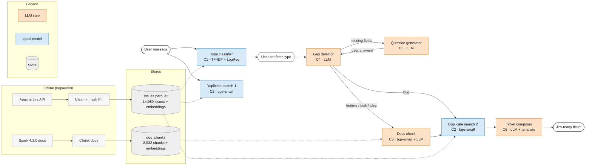
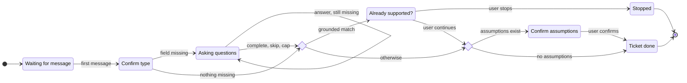
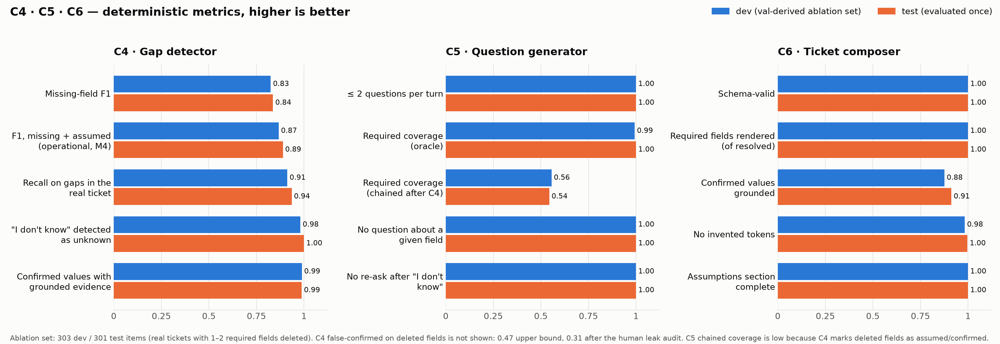

# Ticket Intake Assistant for Apache Spark

*UCU NLP course, Assignment 1. Built with the CRISP-DM process. Detailed phase reports: [`01`](01_business_understanding.md) · [`02`](02_data_understanding.md) · [`03`](03_data_preparation.md) · [`04`](04_modeling.md) · [`05`](05_evaluation.md) · [`06`](06_deployment.md); every decision with its alternatives is in [`decisions.md`](decisions.md).*

## Summary

Most Apache Spark Jira tickets are hard to act on: only **3.4%** of bug reports contain the four things a developer needs (how to reproduce, what was expected, what happened, which version).

This project builds a chat assistant that turns a vague message such as *"Spark job fails when I read a big parquet folder"* into a complete Jira ticket:
- it suggests the ticket type;
- it shows related existing issues;
- it asks a few targeted questions (at most 2 at a time);
- for feature requests, it checks the documentation in case the request is already supported;
- it writes the ticket without inventing anything.

In an end-to-end test with 60 real tickets and a simulated user, the assistant recovered **95%** of the required information in **2.3 user turns**, for **$0.0013 per ticket** and under **7 s per turn** (p95). It invented almost nothing: 1.5% of the specific details in its tickets were not in the original. **80%** of its bug tickets contain all four elements, against 3.4% in Spark's history (the target, 90%, is not met).

## 1. The problem

Spark receives about 3.5–4.7 thousand Jira issues a year. The project's contributing guide asks for a clear title, a reproduction for bugs and the affected version, but most tickets fall short:

| Evidence (SPARK issues since 2020) | Value |
|---|---:|
| Bug reports with all four elements (reproduction, expected, actual, version) | **3.4%** |
| Issues with an empty description | 36.7% |
| Resolved bugs closed without a fix (Incomplete, Duplicate, Invalid, Cannot Reproduce, …) | 16% |

Every incomplete ticket costs a committer time to triage, and the reporter often waits for nothing. The assistant targets the moment the problem is cheapest to fix: **while the ticket is being written.**

**In scope:** English SPARK tickets of four types (bug, feature, task, idea); a Markdown + JSON ticket the user pastes into Jira.

**Out of scope:** writing to Jira automatically, other Apache projects, and fixing bugs.

## 2. What the assistant does

A session is a short chat with a side panel:
1. **The user describes the problem in their own words.** The assistant suggests the **ticket type** (top 2) and component, and the user confirms with one click. It also shows **related existing issues**.
2. **It asks for what is missing.** It works out which required fields of that ticket type are still missing and asks **at most 2 concrete questions per turn**, for at most 4 turns. The user can type "skip" at any time, or answer "I don't know"; it then stops asking about that field.
3. **For feature, task and idea requests, it checks the Spark documentation.** If the docs show the request is **already supported**, it says so with a link, and the user can stop there.
4. **It runs a second, more precise duplicate check** on the full description.
5. **It writes the ticket.** Anything it inferred rather than heard (for example "PySpark", guessed from the code) is listed under **"Assumptions to confirm"**. The user confirms or corrects each one before the ticket is final.

The output follows the contributing guide: a descriptive title, one section per field, "Unknown (reporter)" where the user did not know, and no priority or fix version (committers set those).

## 3. Data

| Source | What | Used for |
|---|---|---|
| Apache Jira REST API | 31,290 SPARK issues (2020 – Nov 2026) + 158 older Wish issues | type classifier, duplicate search, all test sets |
| Spark 4.3.0 documentation | 245 pages + the generated SQL function and config tables, split into **2,932 chunks** | the documentation check |

**What the data taught us** (`02_data_understanding.md`):
- **The types are very imbalanced:** feature and bug dominate; "idea" (Wish) is 0.3%.
- **Bug reports *show* rather than *describe*:** 49% contain code and 42% a stack trace, but only 19–21% say what was expected or what happened. This is exactly the gap the questions target.
- **2026 looks different:** bug filings jumped about 9× and became templated, developer-written reports. That's why 2026 is kept as a separate "drift" set.
- **Duplicate links are usable:** 484 Duplicate pairs give a real test set for duplicate search.

**Key data decisions** (`decisions.md`, D1–D5):

| Decision | Why |
|---|---|
| Map Jira types to four classes; exclude Sub-tasks | Sub-tasks (39% of SPARK) are fragments of other issues; 56% have no description |
| "Idea" = SPARK Wish issues only, not Wishes from other projects | Those name their own project in 63% of cases, so a model would learn "not about Spark ⇒ idea" |
| Train and test on issues before 2026; 2026 is a drift set | Measure how the classifier copes with the new style |
| A 70/15/15 split, frozen, with duplicates kept in the same split | A duplicate pair across splits would leak the answer |
| Mask e-mails and user names; convert Jira markup to Markdown | Privacy, and a single clean text format |

All test sets are frozen files in `data/eval/`, evaluated once.

## 4. How it works, and why it is built this way

### Data flow



All LLM calls go through one client (`src/llm.py`) to OpenRouter, using `deepseek-v4.1-flash` with reasoning off. The client provides caching, retries, validated JSON output and a call log. Two more models are used only for evaluation, never by the app: a judge (`gemini-3.5-flash-lite`) and a simulated user (`qwen3.5-27b`).

### The six steps and the reasoning behind them

| Step | What it does | Why this design |
|---|---|---|
| **Type classifier** (C1) | Suggests the ticket type and component | A simple TF-IDF model matched the LLM (macro-F1 0.54 vs 0.57, overlapping CIs), and is **free and instant**. Jira types are filing conventions that even a careful human matches only 37% of the time, so the user confirms the type instead of trusting the model. |
| **Duplicate search** (C2) | Finds similar existing issues | A small local embedding model (`bge-small`) beat keyword search and hybrid search on real Duplicate pairs. It runs twice: the first time it shows "related issues" only, because a one-line message gives too many false alarms; the second time, on the full description, it may raise an alert. The alert never blocks the user: a false alarm costs one click, a missed duplicate costs a wasted ticket. |
| **Gap detector** (C4) | Marks every field as confirmed, assumed, missing or "unknown" | Each "confirmed" value must quote the user's words. "Assumed" covers what is inferred, and those values are shown for confirmation later. "Unknown" means the user said they don't know, so the assistant never asks again. |
| **Question generator** (C5) | Asks ≤ 2 questions, required fields first | It is told which fields are already given and which ones the user cannot answer, so it doesn't ask redundant questions. |
| **Docs check** (C3) | "Is this already supported?" | It retrieves the 8 most relevant doc chunks, and the LLM must cite one. It says "already supported" **only** when the named API or config really appears in those chunks; a wrong "yes" would stop a user who needs a ticket. If the check fails, the dialogue simply continues. |
| **Ticket composer** (C6) | Writes the ticket | The LLM writes only the text (title and field descriptions). Code assembles the ticket, so the hard rules ("Unknown (reporter)", the assumptions list, no priority, the correct Jira type) hold by construction, not by prompt. |

### The dialogue as a state machine

The orchestration is an explicit state machine (`src/pipeline.py`) rather than an agent framework. Every step is predictable, testable with mocks, and logged with its latency and cost in the app's **Trace** panel.



**What the transitions mean:**
- **The question loop** ends when no required field is missing, when the user types "skip", or after 4 turns.
- **The first diamond is the docs check** (feature, task and idea only). A grounded "already supported" offers a stop; anything else goes on to the ticket.
- **The second diamond** runs the duplicate check and the composer; assumptions, if any, go to the user.
- **When the user confirms or corrects the assumptions,** the ticket is re-rendered without another LLM call.
- **If a step fails,** the session is kept and the step can be retried.

## 5. A real session

This is the author's manual test of the app; the numbers come from the call log. It ran before the last UX fixes.

| | Step | What happened | Time | Cost |
|---|---|---|---:|---:|
| 1 | User | *"Spark job fails when I read a big parquet folder"* | | |
| 2 | Type classifier | bug 83%, task 8% → the user confirms **bug · SQL** | 9 ms | $0 |
| 3 | Duplicate search 1 | top match *"Lazy file discovery for parquet"*, which is unrelated. It raised an alert, and that is why the first search now shows related issues without an alert | 0.2 s | $0 |
| 4 | Gap detector → questions | missing: reproduction, expected behaviour, version. Asks for **a minimal snippet** and **the version / API / deployment** | 3.2 s | $0.0003 |
| 5 | User | `spark.read.parquet("s3://bucket/events/").groupBy("user_id").count().show()`: *"executor dies with OutOfMemoryError. Spark 4.0.1, PySpark, Kubernetes"* | | |
| 6 | Gap detector → question | only the expected behaviour is missing: *"did it work in a previous version?"* | 3.4 s | $0.0004 |
| 7 | User | *"It should just return the count per user. The same job worked fine on Spark 3.5.1 last month."* | | |
| 8 | Gap detector, duplicate search 2 | all four bug elements are now confirmed, plus "regression since 3.5.1"; related issues: memory-limit and on-heap-memory parquet issues | 1.6 s | $0.0003 |
| 9 | Ticket composer | **"Executor OOM on groupBy().count() over large parquet folder in Spark 4.0.1"**: a Bug with steps (code), expected, actual (error), environment, regression | 0.9 s | $0.0001 |

**Totals:** 3 user messages, 6 LLM calls, about 9 s and **$0.0012**. Every detail in the ticket came from the user. A one-line complaint became a ticket with all four elements, which only 3.4% of historical Spark bugs have.

## 6. How we evaluated it, and the results

**Principles** (followed for every component):
- Tune on development data; evaluate each **test set once**, after the configuration is approved (a lock in the code enforces it).
- Prefer **deterministic metrics** (does the quote occur in the text, is the field present, is the schema valid) over an LLM judge.
- Where people must judge, use **blind human audits**.
- Report targets that were missed, and explain why.

### Component results (test sets)

| Step | Main metric | Result | Target |
|---|---|---:|---:|
| Type classifier | macro-F1 · component top-3 | 0.54 · 0.94 | ≥ 0.37 (human level) · ≥ 0.85 |
| Duplicate search | found in top 5 · false alarms | 0.74 · 0.25 | ≥ 0.60 · ≤ 0.20 (borderline) |
| Docs check | precision of "already supported" · accuracy | 0.63 (8/8 claims cited) · 0.32 | — · ≥ 0.65 |
| Gap detector | finding missing fields (F1, counting "assumed" as found) | 0.89 | — |
| Question generator | right questions, ≤ 2, never re-asking "I don't know" | 1.00 | 100% (≤ 2 per turn) |
| Ticket composer | valid · grounded · invented details | 1.00 · 0.91 · 0.3% | 100% · — · ≤ 5% |



*Gap detector, question generator and ticket composer on the dev and test sets: real tickets with 1–2 required fields deleted, so the gold "missing" answer is known (`scripts/plot_c456_scores.py`).*

### End-to-end (60 real test tickets, simulated user)

A second LLM played the user. It knew a real hidden ticket, opened with one vague sentence, and answered only what it was asked.

| | Model picks the type | **User confirms the type (the real UX)** | Target |
|---|---:|---:|---:|
| Required information recovered | 0.46 | **0.95** | ≥ 0.90 |
| Details not in the original ticket | 3.3% | **1.5%** | ≤ 5% |
| User messages per ticket | 2.4 | **2.3** | ≤ 4 |
| Bug tickets with all four elements | 0.53 | **0.80** | ≥ 0.90 (history: 0.03) |
| Word overlap with the original facts | 0.45 | 0.43 | ≥ 0.80 |
| Cost per ticket · slowest turns (p95) | **$0.0013 · 6.9 s** | | ≤ $0.01 · 8 s |

**What the two columns show:**
- **Letting the user confirm the type is essential.** From one vague sentence, the classifier guesses the right type only 43% of the time, and a wrong type means asking for the wrong fields.
- **Once the type is confirmed, almost everything the original reporter knew ends up in the ticket.** The remaining misses are mostly the simulated user wrongly saying "I don't know".

### Why some scores are not higher
1. **The labels themselves are uncertain.** The author, labelling blind, agreed with Jira's ticket types at macro-F1 0.37; the classifier beats that. The documentation-check labels come from one non-expert, and many describe internal code changes that no documentation can confirm.
2. **The docs check is deliberately strict.** It may only say "already supported" with a citation, and method-level API pages are not in the corpus. So it misses many true cases (recall 0.19) but is mostly right when it does speak.
3. **Short first messages.** The classifier and the first duplicate search see a single sentence, which is why both hand the decision to the user.
4. **Measurement limits.**
   - **Word overlap** penalises paraphrases ("drops" vs "dropped").
   - **Deleted fields leak back.** In the ablation tests, a deleted field often survives in the title or a code block. A blind human audit of 20 cases showed that 69% of the gap detector's apparent misses were such leaks, so its real error rate is 0.31 rather than 0.47.

**The LLM judge did not work.** An LLM judge for "does this documentation chunk support the answer?" disagreed with the human (κ −0.04), while agreeing with itself 87% of the time. The two simply used different definitions of "support". The project adopted the judge's stricter definition, reported the judge numbers as uncalibrated, and used deterministic checks for all later components.

## 7. How the project evolved (CRISP-DM)

The work followed CRISP-DM: business understanding, data understanding, data preparation, modelling, evaluation, deployment. Several times a later phase sent us back to an earlier one. Each of these iterations is logged in both phase reports and in `decisions.md`:

| What we found | Phase it sent us back to | What changed |
|---|---|---|
| Realistic targets need real numbers | Business understanding, written after the EDA | Targets based on measured data; the classifier target set to the human level (0.37) |
| The documentation corpus was missing the SQL function and config tables (they are generated at build time) | Data preparation | The tables were added: first as lists, then one entry per chunk, so that a single function can be found. The author declared this the last iteration, to avoid tuning on 30 examples |
| The gap detector copied whole stack traces and skipped its evidence | Modelling | Prompt v2 (required evidence, short quotes): 0 failures, half the cost |
| The simulated user said "my ticket says…" | Evaluation | Simulator prompt v2 ("speak as yourself") |
| The manual app run showed a false duplicate alert, an overwritten component and alarming red "missing" badges | Deployment | UX fixes before the end-to-end test |
| A failed docs check stopped the dialogue (2 of 120 runs) | Evaluation (post-test) | A failure now continues to the ticket; rechecked separately, without replacing the test numbers |

**Product decisions** that shaped the user experience:
- the user confirms the type;
- duplicate alerts never block;
- "already supported" only with a citation;
- inferred values are always shown for confirmation;
- the LLM writes text while code enforces the rules;
- the first duplicate search never alerts;
- a failed docs check never blocks.

(M1–M7 in `decisions.md`.)

## 8. Limitations

- **One non-expert annotator** made all manual labels and audits, so there is no inter-annotator agreement.
- **Circular gold:** the test answers for the gap detector and the end-to-end evaluation were extracted by a model from the same family as the assistant. Verbatim-quote checks and manual review reduce, but do not remove, this bias.
- **The simulated user** is an LLM. It is sometimes too quick to say "I don't know", once invented a detail, and its first message is synthetic. The hidden test tickets also exist in the duplicate-search corpus, so end-to-end duplicate alerts mostly found the original ticket itself.
- **Jira labels are filing conventions:** ticket type and component reflect how committers file issues, not only what an issue is.
- **Small test sets** where it matters: 24 ideas, 50 docs-check items, 60 dialogues. Confidence intervals are reported throughout.

## 9. Agentic development

The project was built with Claude Code as the coding agent. The rules it worked under:
- **`AGENTS.md`**, the project contract:
  - all LLM calls through one client; models chosen by the author only; prompts versioned;
  - frozen test sets that must never be edited; no tuning on test;
  - a cost estimate before any run over 300 LLM calls;
  - deterministic metrics preferred.
- **`CLAUDE.md`:** plan first for multi-file changes; never start the next phase unasked; propose a commit message per task.
- **Plan-first approvals:** every component started as a written plan (approach, metrics, gates, cost) that the author approved, amended or rejected before any code was written.
- **Safeguards in code:**
  - a test lock (an approved config plus an explicit flag; for the end-to-end test also a matching git commit);
  - budget guards and smoke runs with cost projections;
  - a token cap after one runaway response.
- **Total LLM cost of the whole project: $3.15** (8,512 calls; the model selection bake-off $1.25).
- **Skills:** the workflow that emerged was finally written down as seven reusable project skills in `.claude/skills/` (adding a component, running an eval, labelling tools, LLM judges, CRISP-DM reports, Jira data, user simulation).

### What I did manually

The coding agent wrote most of the code, but every important judgement in this project was made or checked by hand.

**Manual labelling and review (all stored in `data/eval/`):**
- **80 scope labels** for C3, labelled one by one in `label_cli`, then a second **evidence review of 23 items** against the rebuilt documentation corpus.
- **40 blind labels for the C1 human ceiling.** My macro-F1 against Jira types was 0.37, which showed the classes are ambiguous even for a person and became the C1 target.
- **44 judge-calibration labels** (citation support and chunk relevance). They showed the LLM judge applies a stricter definition of "support" than I did; we adopted the stricter one.
- **20 blind audit cases for C4**, which turned its false-confirmed rate from an upper bound of 0.47 into a corrected 0.31.
- **20 clarity ratings** of generated questions (average 2.65 / 3).

**Decisions I made:**
- Approved or changed every agent plan in plan mode before code was written; most plans got additions from me (thread-safe LLM client, Jira-key masking, grounding checks, a headless driver for the end-to-end test).
- Chose the models per role from the bake-off, overriding the cheapest simulator because honesty mattered more than cost.
- Set the data decisions D1–D5 from the EDA: no Sub-tasks, no Wish issues from other projects (class leakage), 2026 as a separate drift set.
- Set stopping rules: test sets evaluated once, at most one prompt revision per component, one declared "last" corpus iteration for C3. When C2's test false-alarm rate came out at 0.25, I kept it instead of re-tuning on test.

**Corrections:**
- Fixed a false attribution: the agent had recorded a spot check as mine that I had not done.
- Restated my scope labels as single non-expert labels and did not relabel anything after seeing model outputs.
- Tested the app by hand and found four problems the unit tests missed (a false duplicate alert on short openers, C4 overwriting the component I had confirmed, optional fields shown as errors, a broken title emoji). These became the M6 fixes before the end-to-end test.

**Agent setup and skills:**
- `AGENTS.md` and `CLAUDE.md` defined the rules the agent followed throughout: CRISP-DM phase reports, a single LLM client, frozen eval sets, plan-first approval, cost estimates before large runs.
- At the end I had the workflow that emerged during the project codified as seven skills (`add-component`, `run-eval`, `labeling-cli`, `llm-judge`, `crisp-dm-report`, `apache-jira-data`, `user-simulator`), each recording the mistakes we actually hit, so the next project starts from them.

## 10. How to run

**Start the app:**

```bash
source .venv/bin/activate
python -m streamlit run app/streamlit_app.py
```

**More detail:**
- [`README.md`](../README.md): setup (an OpenRouter key in `.env`), the data pipeline, every evaluation command and the tests (`python -m pytest -q`, 118 tests, no LLM calls).
- [`06_deployment.md`](06_deployment.md): runtime requirements, cost, known risks and monitoring.
